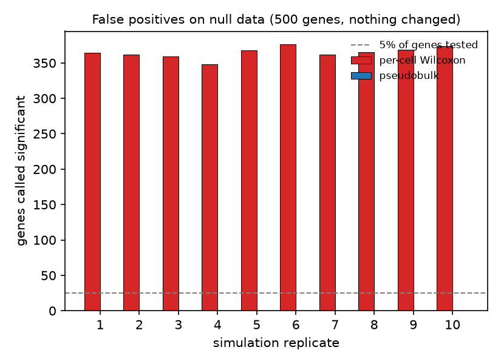
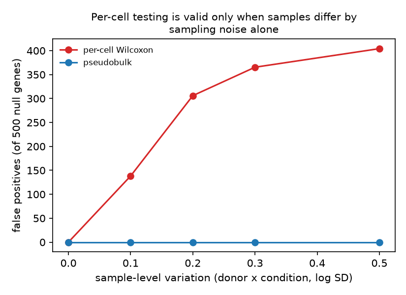
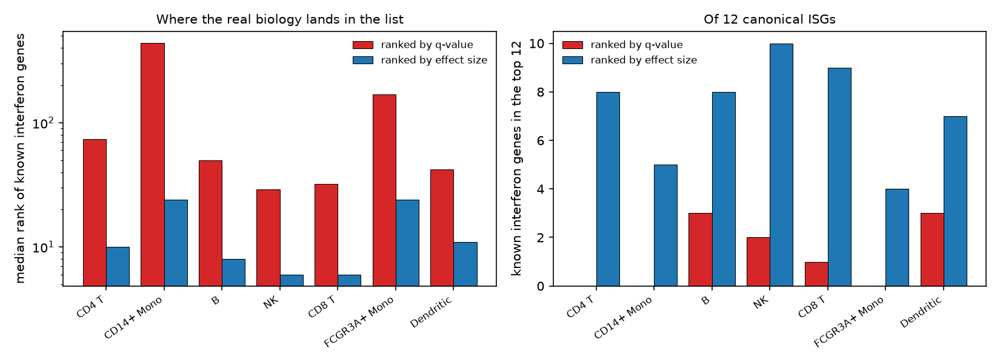

# Differential expression in single-cell data, tested at the right level

Single-cell RNA-seq gives you tens of thousands of cells, and it is tempting
to treat each one as a replicate. This project measures what that costs.

The short version: on simulated data where nothing changes between
conditions, a per-cell Wilcoxon test called **73% of all genes significant**
at a 5% false discovery rate. Pseudobulk aggregation called none.

## The argument

Cells from the same donor are not independent observations. Treating 6,400
cells from 8 donors as 6,400 independent samples inflates the effective
sample size by three orders of magnitude, and the resulting p-values do not
mean what they say. The replicate is the donor, because the donor is what was
randomised.

This is established — Squair et al. (2021, Nat Commun 12:5692) made the case
on real data — but it is still the default in most tutorials, so it is worth
being able to demonstrate rather than cite.

## 1. False positives when nothing is happening

500 genes, 8 donors, 400 cells per donor per condition, zero genes truly
changed. Every significant call is a false positive by construction.



| method | genes called (of 500) |
|---|---|
| per-cell Wilcoxon | 364.7 (72.9%) |
| pseudobulk, paired t-test | 0.0 (0.0%) |

An *uncorrected* p < 0.05 threshold would call about 25 of 500 false positives
on average (5% × 500). Under the Benjamini-Hochberg correction both methods
actually use at q = 0.05, a calibrated test on all-null data calls a mean of
about **0.05 of 500**, not 25 — BH bounds the false-discovery *proportion*
among rejections, so a correct procedure returns essentially nothing here.
That distinction matters for how the mixed-model null below is read.

## 2. It is not buying power

The obvious defence of per-cell testing is that it is more sensitive. It is
not — both methods find essentially everything that is really there.

50 of 500 genes given a real 2-fold effect:

| method | genes called | true positives | false positives | power | observed FDP |
|---|---|---|---|---|---|
| per-cell Wilcoxon | 376.5 | 50.0 | 326.5 | 1.00 | **0.87** |
| pseudobulk | 51.3 | 48.8 | 2.5 | 0.98 | **0.05** |


Both recover all 50 real genes. The per-cell test also returns 326 that are
not real, so 87% of its hit list is wrong. It is not finding more, it is
calling more.

## 3. Why — and the test that proves it

A finding like that is only worth something if the mechanism is identified,
so that you know when it applies.

The claim is that the per-cell test fails because it ignores *sample-level*
variation: everything that differs between two aliquots of the same donor's
cells, such as processing day, capture efficiency, or how that individual
happened to respond. The per-cell test sees thousands of cells all agreeing
and reads one sample's idiosyncrasy as strong evidence.

If that is the cause, the test should be perfectly well behaved when there is
no sample-level variation, and degrade as it grows:



| sample-level SD | per-cell false positives | pseudobulk |
|---|---|---|
| 0.00 | 0.0 | 0.0 |
| 0.10 | 138.2 | 0.0 |
| 0.20 | 306.0 | 0.0 |
| 0.30 | 365.4 | 0.0 |
| 0.50 | 404.2 | 0.0 |

It is exactly calibrated at zero and collapses immediately. The per-cell test
is not broken in general — it is a valid test of the question "did these
cells come from the same distribution", which is simply not the question
anyone is asking. The question is whether the *condition* did something, and
that has 8 replicates, not 6,400.

This also says when per-cell testing is fine: comparing cell types within one
sample, where there is no sample-level confound.

## 4. Normalisation, and a bias that grows with study size

Building this turned up a second problem that had nothing to do with the
first.

Normalising pseudobulk profiles by total count assumes every sample contains
the same amount of RNA. When 50 genes go up strongly they take up more of the
library, so every other gene's share goes down even though nothing happened
to it. In the first version of the simulation this shifted every null gene by
−0.07 log₂ CPM, consistently enough across donors that the paired test called
163 of them significant — a 57% false discovery rate from a method that was
otherwise correct.

Switching to median-of-ratios size factors (what DESeq2 uses) fixed it. But
the interesting part is what happened next: once realistic sample-level noise
was added, the two normalisations looked identical at 8 donors.


| donors | median-of-ratios FDP | total-count CPM FDP |
|---|---|---|
| 8 | 0.043 | 0.049 |
| 20 | 0.059 | 0.098 |
| 40 | 0.059 | **0.192** |

Composition bias is a *bias*: it is the same in every sample, so averaging
over more donors does not reduce it. Sampling noise does shrink. So the ratio
of bias to noise grows, and a normalisation choice that is invisible on 8
donors becomes the dominant source of error on 40. This runs against the
intuition that more data makes methodological choices matter less.

## 5. The same experiment on real data

Kang et al. 2018: PBMCs from 8 lupus patients, each split into a control and
an interferon-β-stimulated aliquot (24,673 cells, GEO GSE96583).

Taking **control cells only** — where no donor differs from any other by
treatment — and randomly splitting the 8 donors into two fake "conditions",
20 times, in CD14+ monocytes:


| method | median false positives | max | median share of the 2,000 genes tested | mean share |
|---|---|---|---|---|
| per-cell Wilcoxon | 307 | 988 | 15.4% | 19.8% |
| pseudobulk | 0 | 1 | 0.0% | 0.0% |

(Share = false positives / genes tested per split, over the 20 splits in
`results/false_positives.csv`; the median share is 307/2,000 = 15.4%, and
19.8% is the *mean* share, i.e. a mean of 395.9 calls. An earlier version of
this row mixed the two statistics.)

The simulation was not exaggerating.

## 6. The positive control, and a ranking problem

A method that calls nothing is trivially free of false positives, so the
other half of the claim has to be checked: does pseudobulk still find the
real response?

Interferon-β produces one of the best characterised transcriptional
programmes in immunology, so the answer is known in advance. In CD14+
monocytes the effects are enormous — CXCL10 +9.8 log₂, IFIT1 +8.6, RSAD2
+8.3, ISG15 +7.7 — and all are significant.

But ranked by q-value, the median known interferon gene sits at **rank 441**
in that cell type, and none appear in the top 12.



The cause is the degrees of freedom. A paired t-test on 8 donors has 7 df,
which puts a floor under how small a p-value can be: the smallest q reached
anywhere in that analysis is 1.5 × 10⁻⁶. Hundreds of genes pile up against
that floor, and their order is then decided by noise. A gene with a modest
but very consistent change outranks one with a 400-fold change that wobbles
slightly between donors.

Ranking the *same significant genes* by effect size instead:

| cell type | median ISG rank by q | by effect size | ISGs in top 12 by q | by effect size |
|---|---|---|---|---|
| CD4 T | 74 | 10 | 0 | 8 |
| CD14+ Mono | 441 | 24 | 0 | 5 |
| B | 50 | 8 | 3 | 8 |
| NK | 29 | 6 | 2 | 10 |
| CD8 T | 32 | 6 | 1 | 9 |
| FCGR3A+ Mono | 170 | 24 | 0 | 4 |
| Dendritic | 42 | 11 | 3 | 7 |

Median rank across cell types goes from 50 to 10.

**Which "rank".** Three different rank definitions appear in this README, and
the numbers are not interchangeable. (a) This table (`results/real_analysis_summary.csv`,
`scripts/real_analysis.py`): rank *within the genes already significant* at
BH q < 0.05, ordered by q or by |log₂FC|, median over the 12 ISGs truncated to
an integer. (b) §7 (`results/celltype_isg_recovery.csv`): the same definition,
but computed after restricting to donors usable in *every* type, so a few
medians differ by 1–2 (CD4 73 vs 74, CD8 31 vs 32, FCGR3A+ monocytes 172 vs 170).
(c) §9 (`results/nbglm_real_summary.csv`): rank among *all tested genes* by q,
median of the 12 ISGs not truncated (hence values such as 73.5). Only
comparisons made inside one definition are meaningful.

So: use the p-value as a filter, and the effect size as the ranking. Sorting
a results table by p-value is close to universal and, at these replicate
counts, close to arbitrary.

## 7. Cell type first, or the composition shift is the result

Everything above aggregates a donor's cells and compares conditions. That is
correct for the donor structure and still wrong for one specific reason: if
the *mix* of cell types differs between conditions, the comparison is
between two different cell mixtures, not between two expression states. Every
marker of whichever type became more common comes out "up", with valid
p-values, for a question nobody asked.

On Kang the composition does move, but only slightly.

**Sign convention, stated once: the log₂ ratio in this table is stim / ctrl.**
`results/celltype_composition_shift.csv` stores the *opposite* sign
(`log2_ratio` = ctrl / stim, because conditions are taken in sorted order:
`mean_prop_a` is ctrl, `mean_prop_b` is stim; `tests/test_celltype_pseudobulk.py`
pins this). The README column below is that file's `log2_ratio` with the
sign flipped, and the proportions are from `celltype_composition_paired.csv`.

| cell type | mean proportion ctrl | stim | log₂ ratio (stim / ctrl) |
|---|---|---|---|
| CD14+ Monocytes | 0.254 | 0.238 | −0.10 |
| Megakaryocytes | 0.015 | 0.012 | −0.30 |
| CD4 T cells | 0.440 | 0.448 | +0.03 |
| NK cells | 0.067 | 0.068 | +0.01 |
| B cells | 0.098 | 0.102 | +0.07 |

Largest shift 0.30 log₂ (1.2×), and it is a *decrease*: megakaryocytes fall
from 1.51% to 1.22% of cells. CD14+ monocytes also fall (0.254 to 0.238),
while CD4 T, B and NK cells rise slightly. Every sign here is the reverse of
what an earlier version of this table claimed — the CSV's `mean_ctrl` and
`mean_stim` columns had been read in the wrong order. `results/celltype_composition_paired.csv`
is the source of record for the proportions (it has no log₂ column; the ratio
is computed from its `mean_stim` and `mean_ctrl`), and the per-donor
proportions agree (CD14+ falls in 7 of 8 donors).

Interferon-β does not, here, rearrange the
PBMC composition much — which is worth stating plainly, because it means this
dataset is *not* the case where pooling fails for that reason, and a
different dataset (or a disease contrast, which is where composition effects
usually bite) would be.

Stratifying by cell type changes the answer anyway, and for a second reason:
different cell types have genuinely different responses.

| cell type | donors | genes tested | significant (BH within type) | (BH global) |
|---|---|---|---|---|
| CD14+ Monocytes | 8 | 5,364 | 2,952 | 2,578 |
| CD4 T cells | 8 | 7,048 | 986 | 1,191 |
| FCGR3A+ Monocytes | 5 | 2,673 | 746 | 717 |
| Dendritic cells | 5 | 2,078 | 565 | 551 |
| B cells | 8 | 3,804 | 563 | 661 |
| NK cells | 7 | 2,436 | 401 | 459 |
| CD8 T cells | 5 | 2,081 | 88 | 187 |
| Megakaryocytes | 1 | — | not testable | — |

**All 8 cell types in the dataset are covered, 7 by an expression test and
8 by the composition test.** Megakaryocytes get a composition result — they
are the largest shift in the table above (−0.30 log₂, 1.51% → 1.22% of
cells, paired t = −0.91, p = 0.39 on all 8 donors) — and they do *not* get an
expression result. That exclusion is not a threshold that could be relaxed,
and the earlier version of this README implied it was by quoting only the
≥25-cell rule. `scripts/megakaryocyte_check.py` settles it with the counts:

| donor | ctrl | stim | total |
|---|---|---|---|
| patient_1039 | 53 | 58 | 111 |
| patient_1256 | 2 | 4 | 6 |
| patient_1244 | 1 | 3 | 4 |
| patient_1015 | 1 | 3 | 4 |
| patient_1488 | 4 | 0 | 4 |
| patient_101 | 1 | 0 | 1 |
| patient_1016 | 1 | 0 | 1 |
| patient_107 | 0 | 1 | 1 |

132 cells across 8 donors, but `patient_1039` supplies **111 of them
(84%)**.

No threshold fixes this, and that is the point the earlier README obscured.
Sweeping it (`results/megakaryocyte_threshold_sweep.csv`): ≥25 cells → 1
donor; ≥10 → 1; ≥5 → 1; ≥3 → 1; ≥2 → 2; ≥1 → 4. A paired design only
appears at ≥1 cell, which is not a design: it would pair 58-cell profiles
against 1-cell profiles and call them equally informative replicates, with
84% of the type from one donor.

Run at that loosest threshold the test has almost nothing to work with: 85
genes survive filtering, the median paired log₂ SD is 0.80, and the minimum
detectable effect at 80% power is **1.67 log₂ (3.2×)** — larger than anything
in the interferon programme here — and 0 genes are called. That is a power
statement, not a biological one: megakaryocytes may respond, this dataset
cannot say. `results/megakaryocyte_summary.csv` records
`expression_test_reliable = False` alongside the numbers,
`results/megakaryocyte_threshold_sweep.csv` the full sweep, and
`results/megakaryocyte_donor_counts.csv` the counts above.

Pooled over all cells: **3,211** genes significant. Stratified: **3,512**
distinct genes significant somewhere. But the overlap is far from complete —
**763** genes are significant pooled and in no cell type, and **1,064** are
significant in at least one cell type and not pooled. Those two numbers are
the point: the pooled answer is not a superset or a subset of the stratified
one, it is a *different* answer. What this analysis does **not** establish is
why. The composition shift measured above is small (largest 0.30 log₂), so
cell-type composition is unlikely to be the whole explanation here; different
responses across types being averaged together, and differences in which
genes pass each filter, are other candidates that were not separated.

The interferon programme survives the split intact — all 12 known ISGs are
significant in all 7 testable cell types — but its *size* is cell-type
specific: 2,952 genes in CD14+ monocytes against 88 in CD8 T cells. A single
pooled number (3,211) describes neither.

## 8. Mixed-effects models: the middle ground, measured on all seven cell types

Pseudobulk is right about the degrees of freedom and wasteful about the
cells. A mixed model keeps both: `expression ~ condition + (1 | donor)`
estimates the condition effect from the within-donor contrast while treating
donor as a variance component rather than a replicate.

**This section was wrong for as long as it was CD4-only.** The first version
ran the comparison on the CD4 T cell subset and then wrote the conclusion as a
statement about mixed models. One subset of eleven thousand cells is not a
property of a method, and the six other testable types had never been run.
`scripts/mixed_vs_others.py` now loops over all seven. Megakaryocytes remain
excluded for the reason in §7: 132 cells, and they do not supply a donor
panel after the min-cells filter.

Per type — cells, the number of donors that contribute one profile to each
condition, and the calls at BH q < 0.05:

| cell type | cells | paired donors | genes | per-cell Wilcoxon | pseudobulk paired t | mixed (1 \| donor) | mixed / pb | log₂FC r | mixed wall clock |
|---|---|---|---|---|---|---|---|---|---|
| CD4 T cells | 11,238 | 8 | 7,048 | 2,112 | 986 | 1,875 | 1.90× | 1.000 | 121.2 s |
| CD14+ Monocytes | 5,697 | 8 | 5,364 | 3,836 | 2,952 | 3,514 | 1.19× | 1.000 | 91.6 s |
| B cells | 2,651 | 8 | 3,804 | 979 | 563 | 1,011 | 1.80× | 1.000 | 69.9 s |
| NK cells | 1,716 | 7 | 2,436 | 581 | 401 | 785 | 1.96× | 1.000 | 42.7 s |
| CD8 T cells | 1,621 | 5 | 2,081 | 366 | 90 | 428 | 4.76× | 0.990 | 34.0 s |
| FCGR3A+ Monocytes | 1,089 | 5 | 2,683 | 1,322 | 771 | 1,427 | 1.85× | 0.994 | 45.8 s |
| Dendritic cells | 529 | 5 | 2,084 | 901 | 562 | 1,092 | 1.94× | 0.998 | 25.0 s |

Five things replicate across all seven, and they are the five the CD4-only
version claimed:

* the fold changes agree — Pearson r between the two donor-aware methods is
  0.990 to 1.000 on every type, so the mixed model is estimating the same
  effect, not a different one;
* the mixed model calls more genes than pseudobulk on every type, by between
  1.19× (CD14+ monocytes, where there is the least left to find) and 4.76×
  (CD8 T cells, where the paired t is working with five pairs);
* the extra calls are not simply per-cell noise: 44–70% of them are also
  significant under the per-cell Wilcoxon, so they are loci with some signal
  rather than pure chatter, but a call the per-cell test also makes is not
  automatically a true one, since the per-cell test is the one §1 shows is
  broken;
* convergence is not a problem anywhere — 98.8% to 100% of fits converge
  under Powell, worst on the two types with five pairs and few cells;
* all 12 ISGs are significant under all three methods on all seven types.

The cost is also consistent: 12.0 to 18.4 ms per gene for pseudobulk-profile
fits. Against the vectorised paired t-test on the same genes that is 152× to
458× on the six types whose pseudobulk fit took at least 0.1 s; the Dendritic
pseudobulk fit rounds to under 0.05 s, so its ratio is at least 500× rather
than measurable at this timing resolution.
Per-cell fits (a donor-stratified subsample of at most 3,200 cells, 400
genes) run 13.4–20.9 ms per gene and converge 99.8–100% of the time, so the
"cells instead of profiles" version buys nothing that the profile version
does not already have at this cell count.

### The donor-swap null, and the two ways to get it wrong

Permuting which of a donor's two aliquots is called "stim" makes the true
answer "nothing" while leaving the donor structure intact — the permutation
moves labels, never cells, and `tests/test_permutation.py` pins that
property. The script re-checks it on every draw and raises if it fails.

Two corrections had to be made to the null itself before it meant anything.

**The reference.** Significance is called on Benjamini-Hochberg q < 0.05 over
the 500 genes, not on raw p < 0.05. Under a complete null with m = 500,
BH at q = 0.05 rejects a mean of about **0.05 genes**, not 25: BH bounds the
proportion of false discoveries among *rejections*, so a calibrated procedure
on all-null data returns essentially nothing. A simulation over 5,000 draws
gives 0.055 mean rejections and P(any) = 0.049. Every ratio below is against
that reference.

**The draws.** Flipping each donor with a 0.5 coin gives a Binomial(n, 1/2)
number of flips, so a draw can leave most donors carrying their real
condition effect; the paired contrast then does not average to zero and a
method that correctly finds the *real* effect is scored as a false positive.
A balanced draw flips exactly half the paired donors, so the flipped and
unflipped halves cancel and the truth really is "nothing"
(`permutation.balanced_swap_plan`). With an odd number of paired donors one
donor is held out per draw, because k = n/2 is not an integer and rounding
leaves one donor carrying its effect every time. 10 balanced draws, 500
genes, per type:

| cell type | paired donors | pseudobulk FP/500 | mixed FP/500 | mixed observed/expected | *unbalanced* pb / mx |
|---|---|---|---|---|---|
| CD4 T cells | 8 | 0.0 | 0.8 | 16× | 0.1 / 5.1 |
| CD14+ Monocytes | 8 | 0.0 | 0.6 | 12× | 0.0 / 6.4 |
| B cells | 8 | 0.0 | 1.4 | 28× | 0.1 / 5.2 |
| NK cells | 7 | 0.0 | 3.3 | 66× | 0.0 / 9.4 |
| CD8 T cells | 5 | 0.0 | 13.6 | 272× | 2.2 / 16.7 |
| FCGR3A+ Monocytes | 5 | 0.0 | 8.6 | 172× | 14.7 / 44.6 |
| Dendritic cells | 5 | 0.0 | 8.6 | 172× | 12.6 / 36.2 |

(The right-hand column is recorded for contrast, not as a null: those draws
retain the real effect in the unflipped donors, which is why the numbers are
larger and why they are not the numbers to judge a method by.)

Two patterns are stable: **pseudobulk is exactly at the expectation on all
seven types** (0.0/500 every time — calibrated, not over-conservative), and
**the mixed model is above the expectation on all seven**, by 12× at best and
272× at worst.

The magnitude is not uniform, and it is monotone in the donor count: 12–28×
with eight paired donors, 172–272× with five (r = −0.96 between paired donors
and the log ratio across the seven types — an association on a sample of
seven, not a controlled experiment). CD4 is therefore the *most* favourable
case for the mixed model, not a typical one, so the old CD4-only section
understated the problem rather than overstating it. The plausible mechanism
is that the paired t-test is exact at any n while the mixed model's Wald
standard error is asymptotic and its random intercept is estimated from very
few pairs (median donor variance 0.014–0.037, 32–44% of genes at the 1e-6
boundary); that reading is not separately tested here, and the measured
pattern is what should be relied on.

What that does and does not mean for the extra calls: on CD8 T cells the
mixed model's null inflation is 13.6/500 = 2.7% per gene, which scaled to
2,081 genes is roughly 57 expected false positives — against 338 extra calls
over pseudobulk. So the null inflation does not account for all of the
difference, but it does mean the mixed model's additional calls carry an
error rate that pseudobulk's 0.0/500 does not. Both statements are measured;
neither one licenses calling the extra genes real.

An earlier version of this section compared both arms against 25/500
(5% × 500), the expectation for an *uncorrected* p < 0.05 threshold, which
made pseudobulk look pathologically conservative and the mixed model nearly
calibrated — the opposite of what the same numbers mean under the correction
the code actually applies. The per-cell Wilcoxon's ~73% false-positive rate on
the simulated null is liberal by either reading.

### The verdict, and how far it holds

The CD4 conclusion was: **the paired t-test on pseudobulk is the right default
when a paired design exists; the mixed model suits the many-cells-one-sample
case.** Across all seven testable types that holds in direction — pseudobulk
is calibrated on every type, the two agree on effect size to Pearson r ≥ 0.990
on every type, and the mixed model is anti-conservative on every type and
152–458× more expensive (at least 500× on the smallest type).

What does *not* generalise is the size of the gap. The CD4 run put the mixed
model at 0.8/500 false positives; five of the seven types are worse than that
and the two worst are 17× worse. Stated as a rule: the fewer paired donors a
type has, the worse the mixed model's null behaves relative to the exact
paired test, so the case for pseudobulk gets *stronger* as a study gets
smaller, not weaker. No type reverses the direction of the verdict.

One caveat, stated because it is a real cost of the conclusion: pseudobulk's
calibration is bought with power on the thin types. On CD8 T cells it calls 90
genes where the mixed model calls 428, and the balanced null cannot tell us
how many of those 338 are real — only that the mixed model's list carries
roughly 57 expected false calls that pseudobulk's does not. The honest
statement is that pseudobulk is the better-calibrated default, not that every
gene the mixed model found beyond it is wrong.

## 9. The NB GLM on real data: what the simulator could not say

Everything in the "still to do" note is simulated. Power and observed FDP
both need genes whose true status is known, and the Kang data has none, so
`scripts/nbglm_real.py` asks the questions that real counts *can* answer:
do the two methods agree on the effect, do they call the same genes, are the
known ISGs found, and how does each behave under a null where the answer is
known by construction.

Same pseudobulk matrix, same gene filter, same BH correction, same 8 paired
donors (ctrl vs 6 h IFN-β). BH q < 0.05:

| cell type | cells | donors | genes tested | pseudobulk | NB GLM | shared | Jaccard | log₂FC r (ρ) |
|---|---|---|---|---|---|---|---|---|
| CD4 T cells | 11,238 | 8 | 7,048 | 986 | 1,362 | 884 | 0.604 | 0.999 (0.999) |
| CD14+ Monocytes | 5,697 | 8 | 5,364 | 2,952 | 3,270 | 2,823 | 0.831 | 0.999 (1.000) |
| B cells | 2,651 | 8 | 3,804 | 563 | 790 | 520 | 0.624 | 0.982 (0.986) |
| NK cells | 1,673 | 7 | 2,436 | 401 | 445 | 336 | 0.659 | 0.976 (0.986) |
| CD8 T cells | 1,542 | 5 | 2,081 | 88 | 168 | 75 | 0.414 | 0.969 (0.979) |
| FCGR3A+ Monocytes | 947 | 5 | 2,673 | 746 | 801 | 611 | 0.653 | 0.994 (0.999) |
| Dendritic cells | 424 | 5 | 2,078 | 565 | 607 | 467 | 0.662 | 0.988 (0.999) |

The GLM calls **more** genes in every cell type, by 7–91%, and the two
lists are far from identical: on CD4 T cells 478 genes are GLM-only against
102 pseudobulk-only. The GLM-only calls are the borderline ones — median
pseudobulk q 0.11 and median |log₂FC| 0.52, against 0.83 for the shared set —
so this is not a second biological programme, it is the GLM promoting genes
the t-test could not quite reach. Fold changes agree to three decimals
because both estimate the same group means; only the standard errors differ.

Runtime for 7,048 genes on CD4 T cells: 0.45 s for the t-test, 2.51 s for
the GLM (~6×). The GLM's Wald fit failed to give a finite standard error on
17 genes across all seven types (0 on CD4 T cells; EDN1, PDGFRL and CH25H
among them), each left at p = 1 rather than dropped.

**The ISGs.** All 12 are called by both methods in 6 of 7 cell types; the
exception is NK cells, where the GLM misses one (CXCL10, one of the 17 failed
fits). Ranks differ sharply: on CD4 T cells median rank 74 under pseudobulk
versus 16 under the GLM, and the same pattern holds everywhere (FCGR3A+
monocytes: 172 vs 11). The GLM orders the real signal more cleanly even
where the call counts are similar.

**The real null.** Labels swapped within donors by
`permutation.swap_cells` — no cell changes donor. Two families of draws,
because they answer different questions. Each is 10 permutations, 7,048
genes, BH q < 0.05:

| family | donors flipped | pseudobulk FP | NB GLM FP |
|---|---|---|---|
| fair coin (k = 4) | 4 of 8 | 0.0 (5 draws) | 0.0 (5 draws) |
| fair coin (k = 5) | 5 of 8 | 0.0 (3 draws) | 41.7 (3 draws) |
| fair coin (k = 6) | 6 of 8 | 0.0 (2 draws) | 247.5 (2 draws) |
| balanced, k = n/2 | 4 of 8 | 0.0 (10 draws) | 0.3 (10 draws, max 3) |

The k-dependence is the whole story and it is not a calibration result. A
swap of k of n donors is only exactly null at k = n/2: at k = 6 of 8 the two
unflipped donors still carry the genuine interferon response, and the GLM
picks it up. So those unbalanced draws — 0 calls at k=4, 28–57 at k=5, 152–343 at k=6 —
read as the GLM finding real residual signal that the t-test is too blunt to see, not as false positives.
The strictly-null family is the balanced one, and there the GLM averages
**0.3 of 7,048** against a calibrated expectation of 0.05. That is not zero
— 3 genes on one draw of ten — but it is the same order, three orders of
magnitude away from the 5%-of-genes reading that BH is often mistaken for.
10 draws cannot resolve 0.3 from 0.05; what they rule out is gross
miscalibration.

**The verdict on the headline.** On real data the GLM calls 7–91% more
genes than the paired t-test, agrees with it almost perfectly on effect size,
ranks the ISGs higher, costs about 6× the runtime and is calibrated to the
same order under a true null. So the simulator's *direction* holds on real
data and its *magnitude* cannot be checked there at all: no real-data
measurement of power is possible without known ground truth, which is why the
97%-vs-68% figure stays labelled simulated and the sentence that guessed at
its real-data size has been replaced by these numbers. Read the extra calls
as a gain in resolution at the same null calibration, not as extra power that
has been demonstrated.

## How the simulation got fixed

The first version of this study produced the opposite of the published
result: the per-cell test looked perfectly calibrated and pseudobulk looked
broken. Both were artifacts.

The simulator applied each donor's random effect identically to that donor's
control and stimulated samples, and gave every sample the same number of
cells. Under that model a donor's two samples differ only by Poisson noise
over hundreds of cells, donor effects cancel exactly when cells are pooled,
and the per-cell test has nothing to trip over. Real experiments are not like
that. Adding an independent per-(donor, condition) effect — `sample_sd` —
reproduced the known behaviour immediately.

Worth recording because the failure mode was quiet: the code ran, produced
plausible tables, and said something false. The thing that caught it was
having a known answer to check against.

## Layout

```
src/scpipe/
    pseudobulk.py   aggregation, median-of-ratios size factors, filtering
    de.py           per-cell Wilcoxon and pseudobulk t-test, BH correction
    simulate.py     negative-binomial counts with donor and sample effects
    preprocess.py   QC thresholds and the standard scanpy pipeline
    data.py         real-dataset loading
scripts/
    simulation_study.py     the four simulation experiments
    false_positive_test.py  the null experiment on real data
    real_analysis.py        ctrl vs stim per cell type, the positive control
    nbglm_study.py          the GLM vs the t-test, simulated (power, FDP)
    nbglm_real.py           the GLM vs the t-test, real Kang counts (§9)
    mixed_vs_others.py      the mixed-model comparison of §8, all 7 cell types
    make_figures.py
tests/              86 tests, including calibration tests that assert the
                    per-cell test fails and that it stops failing when
                    sample-level variance is removed, and driver tests that
                    pin the seven-type roster and the balanced null
```

## Setup

```
pip install -e ".[dev]"
pytest
python scripts/simulation_study.py
python scripts/false_positive_test.py --cell-type "CD14+ Monocytes"
python scripts/real_analysis.py
python scripts/mixed_vs_others.py       # --types "CD4 T cells" for one
python scripts/make_figures.py
```

Note on the dataset URL: `figshare.com/ndownloader/files/34464122` looks like
a download link and is not — it is an async dispatch endpoint that answers
`202` with `Content-Length: 0`, so a naive download writes an empty file and
fails later with an unhelpful h5py error. `src/scpipe/data.py` uses the
scverse host and checks the HDF5 magic bytes and md5 before returning.

Python 3.14 has no anndata or h5py wheels yet; use 3.12 or 3.13.

## Still to do

- ~~Replace the paired t-test on log counts with a proper negative-binomial GLM
  (what DESeq2 and edgeR actually do), and check how much the normal
  approximation costs on small donor counts.~~ **Done** — `src/scpipe/nbglm.py`
  and `scripts/nbglm_study.py`; results in `results/sim_nbglm.csv`.

  The GLM is median-of-ratios size factors as an offset, per-gene method-of-
  moments dispersion shrunk toward an expression trend, and a Wald test on the
  condition coefficient referred to a t distribution with (samples − parameters)
  degrees of freedom. Measured over 10 replicates per cell of the donor grid
  (300 genes, 30 truly changed at log2 effect 1.0, BH α = 0.05): the *power* is
  the column that moved. At **6 donors** the GLM found **97%** of the changed
  genes against **68%** for the paired t-test, at the same observed false
  discovery proportion (0.028 vs 0.042). At **12 donors** both reach 100% power
  (FDP 0.057 vs 0.049) and at **24 donors** both are at 100% (FDP 0.043 vs
  0.059) — identical to two decimals. At **3 donors** neither method calls
  anything: 0% power for both, because the per-sample variance component
  swamps a 2× effect at three pairs regardless of the test. So the normal
  approximation is expensive exactly where it was suspected to be — the 3–8
  donor range where most published designs live — and free above 12. Worth
  noting that this simulator generates negative-binomial data, which is the
  GLM's own model, so this is its best case.

  **Every number in the paragraph above is simulated, not real.** The two
  quantities it reports — power and observed FDP — need genes whose true
  status is known, and the real dataset does not have any, so they can only
  come from a simulator. Which is exactly why the hedge that used to sit here
  ("on real data the gap is unlikely to be larger than this and could be
  smaller") has been replaced by a measurement: `scripts/nbglm_real.py` runs
  both methods on the same real pseudobulk matrix, results in
  `results/nbglm_real_*.csv`. See **§9** below for what came back, and for
  what can and cannot be concluded from real counts.

## Note on how this was built

Written with Claude (Anthropic) as a coding assistant. I set the question,
chose the validation strategy, and interpreted the results. The three
findings I would defend in detail — that the per-cell failure is
specifically caused by unmodelled sample-level variance, that composition
bias grows in relative importance as a study gets larger, and that p-value
ranking is close to arbitrary at these replicate counts — all came from
following up results that did not match what was expected, instead of
accepting output that looked reasonable.