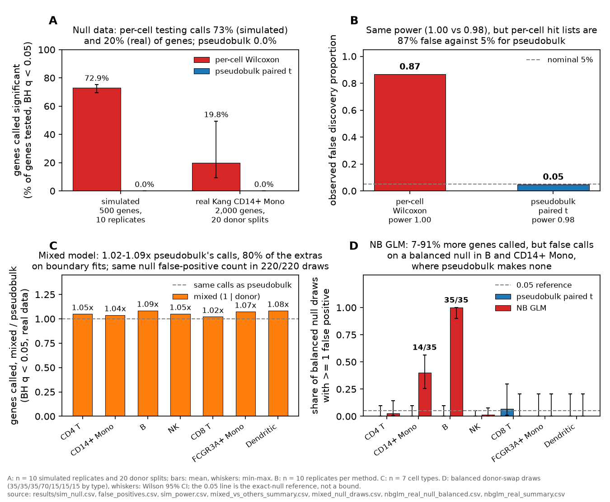
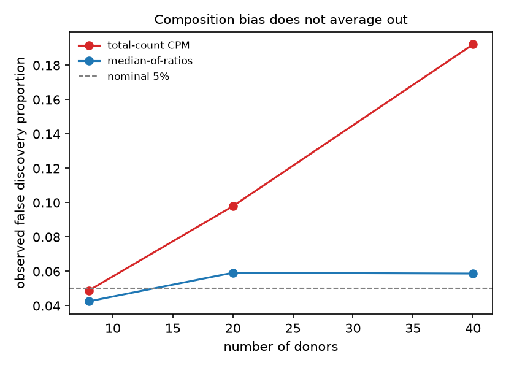
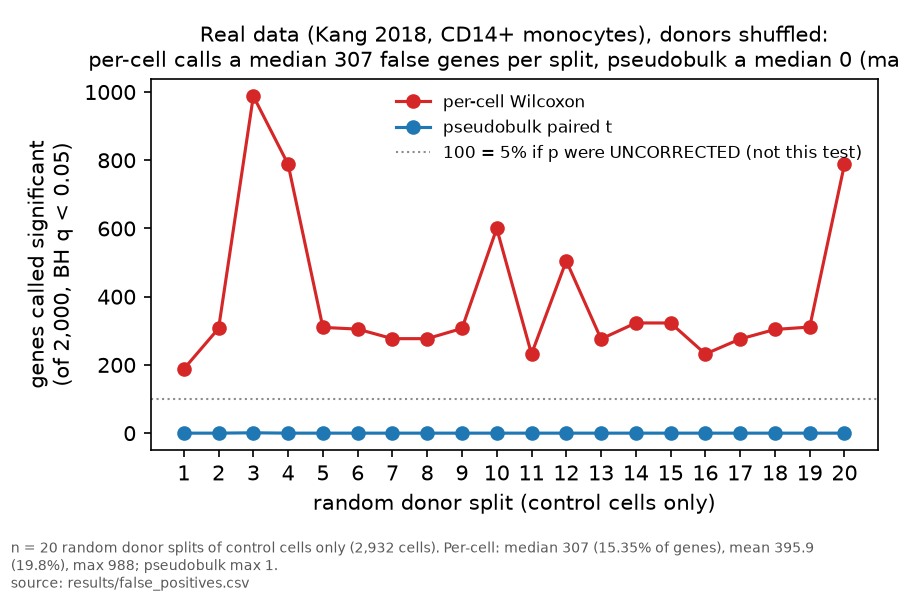
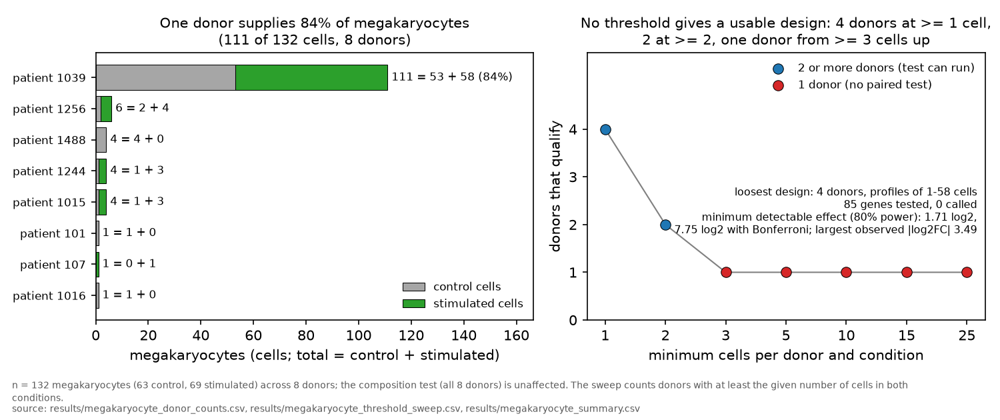
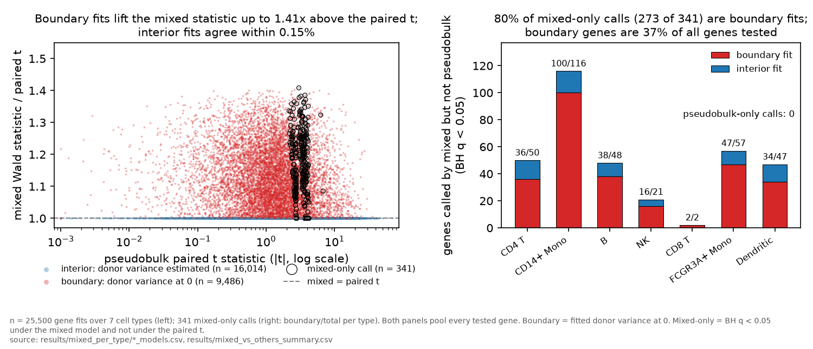
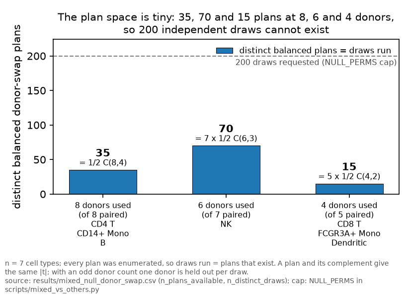
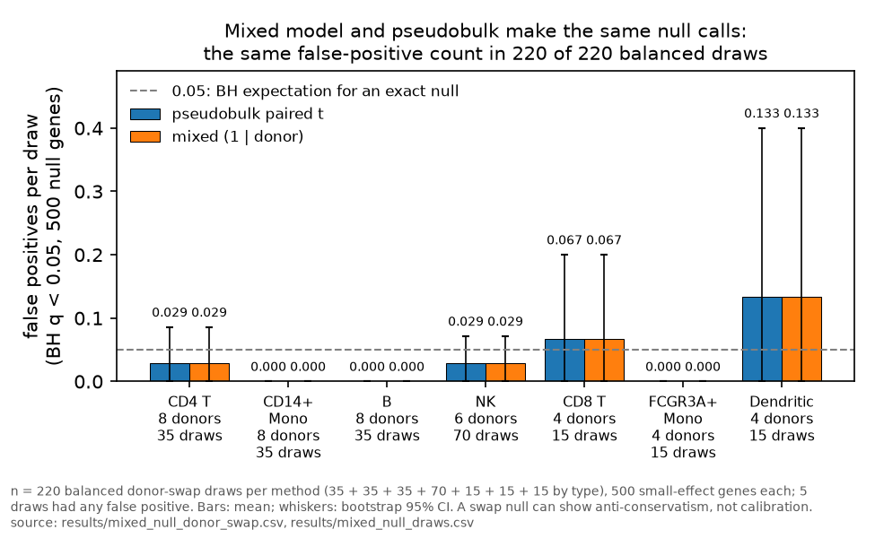
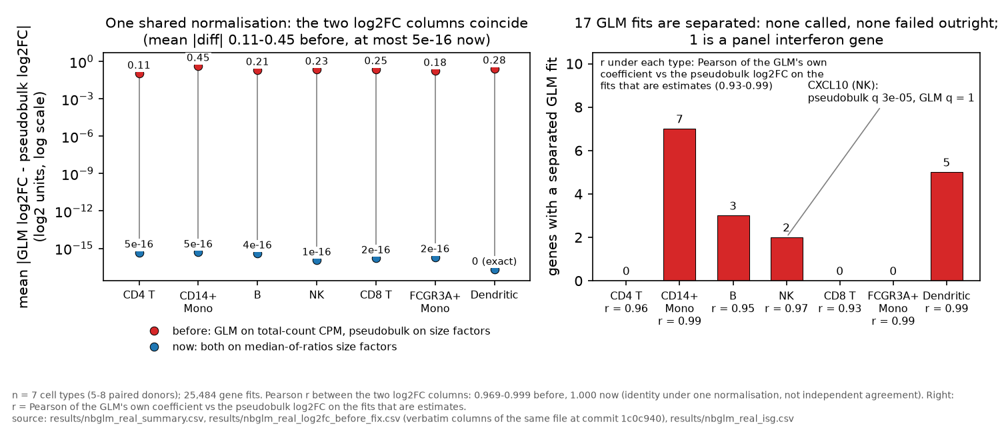
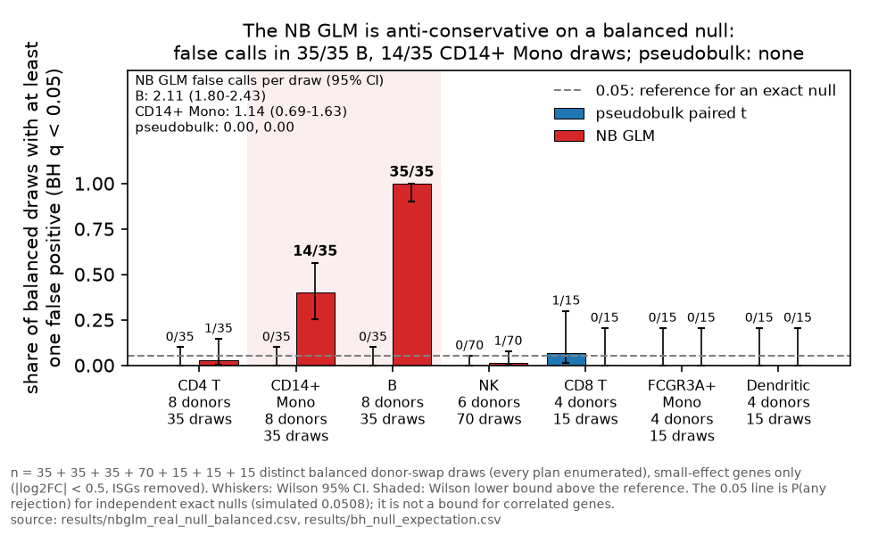
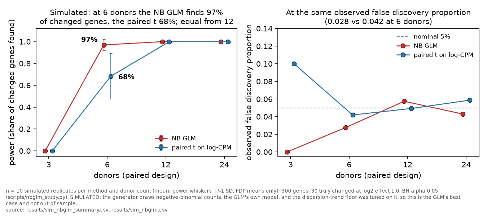

# Differential expression in single-cell data, tested at the right level

[](https://github.com/Qwuantabee/single-cell-de/actions/workflows/tests.yml)
[](https://github.com/Qwuantabee/single-cell-de/blob/main/LICENSE)
[](https://github.com/Qwuantabee/single-cell-de/blob/main/pyproject.toml)

Treating every cell as a replicate is tempting, and this project measures what it costs. On simulated data where nothing changes between conditions, a per-cell Wilcoxon test called **73% of all genes significant** at a 5% false discovery rate; pseudobulk aggregation called none. On real control cells (Kang 2018, CD14+ monocytes, donors split at random) the same test called a median of 15% of genes and pseudobulk a median of 0. The 73% is specific to the simulator's assumed sample-to-sample variation (§3 sweeps it from 0% to 81%). The sections below repeat the test on real data, then hold two alternatives (a mixed model, a negative-binomial GLM) to the same standard.

## At a glance



*A: per-cell testing manufactures false positives on null data, simulated and real; pseudobulk does not. B: at the one effect size and donor count simulated (an e-fold change, 8 donors) per-cell testing finds no more of the true genes (50.0 vs 48.8 of 50); this is not a general power result (§2, Limits). C: the donor-intercept mixed model is the pseudobulk test at far higher cost (§8). D: the NB GLM calls more genes but is anti-conservative on B cells and CD14+ monocytes (§9). C and D correct earlier claims of this repo.*

## The argument

Cells from one donor are not independent observations. Treating 6,400 cells from 8 donors as 6,400 samples inflates the effective sample size by three orders of magnitude, and the p-values stop meaning what they say. The replicate is the donor, because the donor is what was randomised. This is established (Squair et al. 2021, Nat Commun 12:5692) but still the default in most tutorials, so it is worth demonstrating, not citing.

## Limits

- **The 73% is a simulator setting, not a constant of nature.** It is measured at one assumed sample-level SD (0.3 on the natural-log scale, a simulator default chosen by the author; no fit to data is in this repo). §3 shows 0% at SD 0 and 81% at SD 0.5; the real-data figure is 15% (median) to 20% (mean) on one cell type of one dataset.
- **"No power lost" is measured at one point.** One effect size (natural-log effect 1.0: 2.72-fold, 1.44 log₂), 8 donors, 400 cells per sample, 10 replicates: pseudobulk recovers 48.8 of 50 true genes against 50.0. Smaller effects were not simulated against the per-cell test. With fewer donors the pseudobulk paired t does lose power in this repo's own grid (68% at 6 donors, 0% at 3; "Still to do"), and per-cell "power" is not comparable anyway, because 87% of its calls are false.
- **One real dataset** (Kang 2018, 8 donors, one stimulus). The real-data nulls can show anti-conservatism, not calibration (§8, §9), and several have 15–70 draws.
- **Real data has no ground truth**: power and false discovery proportion are simulated only; the simulator draws negative-binomial counts, which is the NB GLM's own model.
- The donor counts, gene filters, ISG panel (12 genes) and the |log₂FC| < 0.5 "small-effect" null set are the author's choices.

## Corrections to this repo's own earlier claims

Each was found by re-running against the committed artefacts, and each is described where it applies.

| what was wrong | where | commit |
|---|---|---|
| Composition table had ctrl and stim swapped, so every sign was reversed | §7 | `6d5fb63` |
| Null reference was 25 of 500 (uncorrected p) where BH expects about 0.05 of 500 | §1, §8 | `b72cde6`, `6f3e0fd` |
| Mixed model reported 12–272× null inflation: a normal reference at 4–8 pairs, and unpaired profiles in the mixed arm | §8 | `7f1e46d`, `96f8026` |
| GLM and pseudobulk log₂FC "agreed to three decimals" while on different normalisations | §9 | `8f09882` |
| Nulls resampled plans that do not exist as distinct draws; GLM "calibrated" on one type and ten draws | §8, §9 | `eb13b69`, `4b90d2a` |
| Simulated effect labelled 2-fold / log₂ 1.0; it is 1.0 on the natural-log scale (2.72-fold) | §2, Still to do | this revision |

The simulator fix described under "How the simulation got fixed" and the first-version normalisation numbers in §4 predate the first commit, so they are narrated here and cannot be checked from the history.

## 1. False positives when nothing is happening

500 genes, 8 donors, 400 cells per donor per condition, zero genes truly changed: every call is a false positive by construction (no gene has a condition effect; each sample gets an independent shift with SD 0.3 on the natural-log scale, the simulator default, swept in §3).


*Per-cell Wilcoxon calls 364.7 of 500 genes (72.9%); pseudobulk paired t calls 0.0 (BH q < 0.05, 10 replicates).*

The dashed line is the *uncorrected* p < 0.05 expectation (5% × 500 = 25). Under the Benjamini-Hochberg correction both methods use at q = 0.05, a calibrated test on all-null data calls a mean of about **0.05 of 500**, not 25: BH bounds the false-discovery *proportion* among rejections, so a correct procedure returns essentially nothing. That distinction matters for how the mixed-model null in §8 is read.

## 2. It is not buying power (at the effect size tested)

The obvious defence of per-cell testing is sensitivity. With 50 of 500 genes given a real effect of 1.0 on the natural-log scale (2.72-fold, 1.44 log₂; an earlier version of this sentence called it 2-fold, but `simulate.py` applies the effect inside `exp`), 8 donors, per-cell Wilcoxon calls 376.5 genes (50.0 true, 326.5 false; power 1.00, observed FDP **0.87**) and pseudobulk calls 51.3 (48.8 true, 2.5 false; power 0.98, FDP **0.05**).


*Both recover the real genes; per-cell also returns 326 that are not real, so 87% of its hit list is wrong. It is not finding more, it is calling more.*

This is one effect size at one donor count, not a power curve. Pseudobulk's power falls with fewer donors (68% at 6 and 0% at 3 for the same paired t in the grid under "Still to do"), and no smaller effect was simulated against the per-cell test, so "loses no power" holds here and is not shown elsewhere. A per-cell test that calls three quarters of all genes will always contain the true ones; that is not power in any useful sense.

## 3. Why — and the test that proves it

The per-cell test ignores *sample-level* variation: everything that differs between two aliquots of one donor's cells (processing day, capture efficiency, that individual's response). It sees thousands of cells agree and reads one sample's idiosyncrasy as strong evidence. If that is the cause, the test should behave when sample-level variation is zero and degrade as it grows.


*Per-cell false positives (of 500 null genes) at sample-level SD 0.00 / 0.10 / 0.20 / 0.30 / 0.50: 0.0 / 138.2 / 306.0 / 365.4 / 404.2; pseudobulk 0.0 throughout.*

It is exactly calibrated at zero and collapses at once. The per-cell test is not broken in general: it validly tests "did these cells come from the same distribution", which nobody asks. The question is whether the *condition* did something, and that has 8 replicates, not 6,400. Per-cell testing is fine for comparing cell types within one sample, where there is no sample-level confound.

## 4. Normalisation, and a bias that grows with study size

Total-count normalisation assumes every sample holds the same amount of RNA. When 50 genes go up strongly they take up more of the library, so every other gene's share falls though nothing happened to it. In the first version of the simulation this shifted every null gene by −0.07 log₂ CPM, consistently enough across donors that the paired test called 163 of them significant (a 57% false discovery rate from an otherwise correct method). Median-of-ratios size factors (as in DESeq2) fixed it, and with realistic sample-level noise the two normalisations looked identical at 8 donors.



*False discovery proportion at 8 / 20 / 40 donors: median-of-ratios 0.043 / 0.059 / 0.059, total-count CPM 0.049 / 0.098 / **0.192**.*

Composition bias is a *bias*: the same in every sample, so more donors do not average it out while sampling noise shrinks. A choice invisible at 8 donors dominates the error at 40, against the intuition that more data makes methodological choices matter less.

## 5. The same experiment on real data

Kang et al. 2018: PBMCs from 8 lupus patients, each split into a control and an interferon-β-stimulated aliquot (24,673 cells, GEO GSE96583). Taking **control cells only**, where no donor differs from any other by treatment, and randomly splitting the 8 donors into two fake "conditions" 20 times, in CD14+ monocytes:



*Per-cell Wilcoxon: median 307 false positives per split (max 988; 15.4% of the 2,000 genes tested), mean 395.9 (19.8%). Pseudobulk: median 0, max 1. The simulation was not exaggerating.*

(Share = false positives / genes tested per split, over the 20 splits in `results/false_positives.csv`. 15.4% is the *median* share, 307/2,000; 19.8% is the *mean* share. An earlier version of this row mixed the two statistics. The 20 splits are random draws, not 20 distinct splits: eight donors have only 35 distinct 4-vs-4 splits, and only 14 distinct per-cell counts occur among the 20, six of them twice. This is also an unpaired 4-vs-4 comparison of whole donors, a different design from the paired one used everywhere else.)

## 6. The positive control, and a ranking problem

A method that calls nothing is trivially free of false positives, so check that pseudobulk still finds the real response. Interferon-β is a well-characterised programme, so the answer is known in advance. In CD14+ monocytes the effects are enormous (CXCL10 +9.8 log₂, IFIT1 +8.6, RSAD2 +8.3, ISG15 +7.7) and all are significant. But ranked by q-value, the median known interferon gene sits at **rank 441** in that type, and none is in the top 12.


*Ranking the same significant genes by effect size moves the median interferon-gene rank from 50 to 10 across the seven cell types, and the interferon genes in the top 12 from 9 of 84 to 51 of 84.*

The cause is the degrees of freedom. A paired t-test on 8 donors has 7 df, which floors the p-value (the smallest q in this cell type is 1.5 × 10⁻⁶; across all seven types it is 6.6 × 10⁻⁷, on CD4 T cells). Hundreds of genes pile against the floor and their order is decided by noise, so a modest but very consistent change outranks a 400-fold one that wobbles between donors. Use the p-value as a filter and the effect size as the ranking.

Three "rank" definitions appear in this README and are not interchangeable; compare only inside one.

<details><summary>The three rank definitions</summary>

(a) The figure (`results/real_analysis_summary.csv`, `real_analysis.py`): rank *within the genes already significant* at BH q < 0.05, by q or by |log₂FC|, median over the 12 ISGs truncated to an integer. (b) §7 (`results/celltype_isg_recovery.csv`, `celltype_analysis.py`): the same definition from a different script; its medians differ by 1–2 for three types (CD4 73 vs 74, CD8 31 vs 32, FCGR3A+ monocytes 172 vs 170), and the cause was not isolated (re-sorting with different algorithms did not reproduce it, so it is not tie-breaking alone). (c) §9 (`results/nbglm_real_summary.csv`): rank among *all tested genes* by q, median not truncated (hence 73.5).

</details>

## 7. Cell type first, or the composition shift is the result

If the *mix* of cell types differs between conditions, a pooled comparison compares two cell mixtures, not two expression states: every marker of whichever type became more common comes out "up", with valid p-values, for a question nobody asked. On Kang the composition moves only slightly. Mean proportion ctrl → stim, with the log₂ ratio stim / ctrl: CD14+ monocytes 0.254 → 0.238 (−0.10), megakaryocytes 0.015 → 0.012 (−0.30), CD4 T 0.440 → 0.448 (+0.03), NK 0.067 → 0.068 (+0.01), B 0.098 → 0.102 (+0.07).

The largest shift is 0.30 log₂ (1.2×) and a *decrease* (megakaryocytes, 1.51% → 1.22% of cells); CD14+ monocytes also fall, in 7 of 8 donors. Every sign is the reverse of an earlier version of this table, whose `mean_ctrl` and `mean_stim` columns had been read in the wrong order (commit `6d5fb63`). Interferon-β does not rearrange PBMC composition much, so this dataset is *not* the case where pooling fails for that reason; a disease contrast, where composition effects usually bite, would be.

<details><summary>Sign convention</summary>

The log₂ ratio above is stim / ctrl, the opposite of `results/celltype_composition_shift.csv` (`log2_ratio` = ctrl / stim; `mean_prop_a` is ctrl, `mean_prop_b` is stim; `tests/test_celltype_pseudobulk.py` pins this). Proportions come from `celltype_composition_paired.csv`, the source of record (no log₂ column).

</details>

Stratifying changes the answer anyway, because cell types respond differently (CD14+ monocytes 2,952 significant genes, CD8 T cells 88):

<details><summary>Per-type counts (table)</summary>

| cell type | donors | genes tested | significant, BH within type (global) |
|---|---|---|---|
| CD14+ Monocytes | 8 | 5,364 | 2,952 (2,578) |
| CD4 T cells | 8 | 7,048 | 986 (1,191) |
| FCGR3A+ Monocytes | 5 | 2,673 | 746 (717) |
| Dendritic cells | 5 | 2,078 | 565 (551) |
| B cells | 8 | 3,804 | 563 (661) |
| NK cells | 7 | 2,436 | 401 (459) |
| CD8 T cells | 5 | 2,081 | 88 (187) |
| Megakaryocytes | 1 | — | not testable |

</details>

**All 8 cell types are covered: 7 by an expression test, 8 by the composition test.** Megakaryocytes get a composition result (the largest shift above; paired t = −0.91, p = 0.39 on all 8 donors) and no expression result, and that exclusion is not a threshold that could be relaxed (an earlier version implied it was, by quoting only the ≥25-cell rule).



*132 cells across 8 donors, but `patient_1039` supplies 111 (84%); no cell-count threshold leaves a usable design.*

≥25 through ≥3 cells leave 1 donor, ≥2 leaves 2 (a paired t on 1 df) and ≥1 leaves 4; the loosest pairs profiles of 1 to 58 cells as equally informative replicates, with 84% of the type from one donor, and it calls 0 of 85 genes. That is a power statement, not a biological one: megakaryocytes may respond, this dataset cannot say.

<details><summary>Megakaryocyte power numbers</summary>

At the loosest threshold 85 genes survive filtering, the median paired log₂ SD is 0.80, and the minimum detectable effect at 80% power is **1.71 log₂** (exact noncentral-t, the figure to use; 1.67 log₂, 3.2×, by the central-t approximation; **7.75 log₂** with Bonferroni over 85 genes). The largest observed |log₂FC| is 3.49 (ISG15): above the per-gene minimum and well below the Bonferroni one, so one gene responding that much is not ruled out but nothing could survive correction. (An earlier sentence called 1.67 "larger than anything in the interferon programme here"; the observed ISG15 value contradicts that.) Files: `results/megakaryocyte_threshold_sweep.csv`, `megakaryocyte_summary.csv` (`expression_test_reliable = False`), `megakaryocyte_donor_counts.csv`.

</details>

Pooled over all cells, **3,211** genes are significant; stratified, **3,512** distinct genes are significant somewhere. **763** are significant pooled and in no cell type and **1,064** in at least one type and not pooled, so the pooled answer is a *different* answer, not a superset or subset. This analysis does **not** establish why. The composition shift is small (largest 0.30 log₂), so composition is unlikely to be the whole explanation; different responses being averaged, and different gene filters, are other candidates that were not separated. Only 0.52% of the 763 pooled-only genes (4 genes) are among the top-30 markers of any cell type (`pooled_sig_marker_share` in `results/celltype_analysis_summary.csv`), where a composition artefact would put marker genes.

All 12 known ISGs are significant in all 7 testable types, but the programme's *size* is cell-type specific: 2,952 genes in CD14+ monocytes against 88 in CD8 T cells. A single pooled number (3,211) describes neither.

## 8. Mixed-effects models: the middle ground, measured on all seven cell types

Pseudobulk is right about the degrees of freedom and wasteful about the cells. The mixed model here, `expression ~ condition + (1 | donor)` on one pseudobulk profile per donor and condition, is the paired t-test's model plus a donor variance component. A *per-cell* mixed model is not evaluated (below).

**This section was rewritten twice, and the second time the headline reversed.** The first version ran on CD4 only. The second reported the mixed model 12–272× above the null expectation, worse with fewer donors: an implementation artefact (`statsmodels` takes Wald p-values from a *normal* reference, anti-conservative at 4–8 pairs, and the mixed arm used every donor's profile, not the paired donors pseudobulk uses; commits `7f1e46d`, `96f8026`). The numbers below use a t(n_pairs − 1) reference on the paired donors (`results/mixed_vs_others_summary.csv`); megakaryocytes stay excluded (§7).

<details><summary>Calls at BH q < 0.05, per cell type (table)</summary>

| cell type | paired donors | per-cell Wilcoxon | pseudobulk paired t | mixed (1 \| donor) | mixed / pb | genes on the variance boundary |
|---|---|---|---|---|---|---|
| CD4 T cells | 8 | 2,112 | 986 | 1,036 | 1.05× | 34.7% |
| CD14+ Monocytes | 8 | 3,836 | 2,952 | 3,068 | 1.04× | 33.2% |
| B cells | 8 | 979 | 563 | 611 | 1.09× | 43.5% |
| NK cells | 7 | 581 | 401 | 422 | 1.05× | 38.8% |
| CD8 T cells | 5 | 366 | 90 | 92 | 1.02× | 42.2% |
| FCGR3A+ Monocytes | 5 | 1,322 | 771 | 828 | 1.07× | 35.0% |
| Dendritic cells | 5 | 901 | 562 | 609 | 1.08× | 40.4% |

</details>



*Interior fits (donor variance estimated) track the paired t; boundary fits (variance collapsed to 0) run up to 1.41× higher and carry 80% of the mixed-only calls.*

* **Same effect by construction:** the mixed coefficient equals the paired mean difference (max |difference| 7e-15 log₂FC, every gene and type), so r = 1.000 checks the code path, not agreement of independent methods (it was below 1 earlier because the mixed arm used extra unpaired profiles).
* **Same statistic where the donor variance is estimated** (within 0.15% of the paired t; largest |stat/t| 1.0015). On the 33–44% of genes whose random intercept collapsed to zero ("converged", but a pooled fit) it reaches 1.41× the paired t (1.37–1.41 across types); optimiser convergence is 100% and says nothing about this.
* **1.02–1.09× the calls, 80% of the extras on boundary fits:** 341 mixed-only calls, 273 on boundary genes; pseudobulk-only: 0. These are genes where the pooled standard error is smaller than the paired one: a measured difference, not evidence the extras are real. All 12 ISGs are significant under all three methods in all seven types.

The mixed fit costs 138× to 721× the whole pseudobulk pipeline (11.9–20.1 ms per gene). A *per-cell* mixed model is **not evaluated**: nothing here supports "cells instead of profiles buys nothing", and nothing supports the opposite.

<details><summary>Cells, genes and wall clock per type; timing; the per-cell mixed model</summary>

| cell type | cells | genes tested | mixed wall clock |
|---|---|---|---|
| CD4 T cells | 11,238 | 7,048 | 110.2 s |
| CD14+ Monocytes | 5,697 | 5,364 | 83.0 s |
| B cells | 2,651 | 3,804 | 62.6 s |
| NK cells | 1,716 | 2,436 | 48.9 s |
| CD8 T cells | 1,621 | 2,081 | 36.2 s |
| FCGR3A+ Monocytes | 1,089 | 2,683 | 44.1 s |
| Dendritic cells | 529 | 2,084 | 24.8 s |

**Timing.** 11.9–20.1 ms per gene for the mixed fit: 138× to 721× the whole pseudobulk pipeline (aggregation, gene filter, paired t; the fair "swap one method for the other" comparison) and 34,900× to 50,900× the paired t alone (mean of 20 repeats, 0.7–2.3 ms). An earlier "152×–458×" used a pseudobulk time rounded to 0.1 s.

**Per-cell mixed model.** 14.6–35.1 ms per gene on a donor-stratified subsample of at most 3,200 cells and 400 genes, converging 99.75–100% of the time; that is all that is known. It absorbs donor offsets but not the donor × condition (aliquot) variance that §3 blames for per-cell failure, and no null or pseudobulk comparison was run.

</details>

### The donor-swap null, and what it can and cannot show

Permuting which of a donor's two aliquots is called "stim" makes the truth "nothing" for a constant effect while keeping the donor structure; labels move, never cells (`tests/test_permutation.py` pins that; the script re-checks every draw on the frame the model is fed). Null genes are the small-effect set (|paired log₂FC| < 0.5, ISGs excluded) used in §9, 500 at random from 1,041–5,454 per type: random genes would make any method look conservative, since a swapped gene whose real effect varies between donors does not cancel in variance.

<details><summary>Reference and draws</summary>

The reference is BH q < 0.05 over the 500 genes: P(any rejection) = 0.05 for independent exact nulls (§1), simulated at 0.0508 with a mean of 0.0552 ± 0.0035 rejections (`scripts/bh_null_expectation.py`, 5,000 draws, m = 500; `results/bh_null_expectation.csv`). It is a round reference, not a derived bound for a swap null on correlated genes. Draws are *distinct* balanced plans, enumerated, not resampled: a balanced plan flips half the paired donors, a plan and its complement give the same |t|, and with seven paired donors one is held out per draw (`results/mixed_null_draws.csv` records the donors each draw used).

</details>



*The number of distinct draws is the number of plans that exist, not 200: 35 for eight paired donors, 70 for seven (six used), 15 for five (four used).*



*Mixed and pseudobulk make the same false-positive count in 220 of 220 balanced draws (215 with none for either); the artefact records counts, not which genes.*

<details><summary>Per-type numbers behind the figure</summary>

| cell type | paired donors (used) | draws | FP/500, both methods | draws with ≥1 FP (Wilson 95% CI) | raw p<0.05 rate pb / mixed |
|---|---|---|---|---|---|
| CD4 T cells | 8 (8) | 35 | 0.029 | 1/35 = 0.029 (0.005–0.145) | 3.3% / 3.7% |
| CD14+ Monocytes | 8 (8) | 35 | 0.000 | 0/35 (0–0.099) | 3.1% / 3.5% |
| B cells | 8 (8) | 35 | 0.000 | 0/35 (0–0.099) | 3.4% / 3.9% |
| NK cells | 7 (6) | 70 | 0.029 | 2/70 = 0.029 (0.008–0.098) | 3.9% / 4.4% |
| CD8 T cells | 5 (4) | 15 | 0.067 | 1/15 = 0.067 (0.012–0.298) | 3.1% / 3.4% |
| FCGR3A+ Monocytes | 5 (4) | 15 | 0.000 | 0/15 (0–0.204) | 3.2% / 3.4% |
| Dendritic cells | 5 (4) | 15 | 0.133 | 1/15 = 0.067 (0.012–0.298) | 4.0% / 4.2% |

Pseudobulk and mixed means are equal in every row; bootstrap CIs for the mean FP are in `results/mixed_null_donor_swap.csv` (CD4: 0.029, 0–0.086). That file also holds a contrast arm with an *unbalanced* coin flip (10 draws per type, `is_null = False`, no expected-FP ratio) in which the unflipped donors keep their real effect, so it is not a null.

</details>

* Mixed and pseudobulk make **the same number of false positives in 220 of 220 balanced draws**: after the t reference the mixed model is not anti-conservative on this null in any type.
* Both fit the 0.05 reference (0–6.7% of draws have ≥1 FP; CIs reach 10–30% on the 15-plan panels), but there are **too few draws to tell** calibrated from mildly anti-conservative.
* The raw per-gene rate of p < 0.05 is 3.1–4.4%, below the 5% a calibrated test gives, because the swapped contrast keeps the real between-donor spread. **The null can show anti-conservatism, not over-conservatism or exact calibration**; "0 false positives" is what a conservative null gives either method. (The earlier "pseudobulk is exactly at the expectation, calibrated" was unsupported and is removed.)

### The verdict, and how far it holds

The paired t on pseudobulk and the (1 | donor) mixed model on the same profiles are **the same test with different standard errors on a third of genes**: identical effects and statistics where the variance component is estimated, about 5% more calls on boundary genes (80% of the extras), for over two orders of magnitude more computation. That favours the paired t as the default when a paired design exists; it does not show the mixed model is wrong, because nothing here separates a true extra call from a false one.

No longer true, though true of the earlier version: the null inflation (12–272×), its dependence on donor count (r = −0.96 across seven types), "the case for pseudobulk gets stronger as a study gets smaller" (that was the degrees of freedom of the mixed arm's reference distribution, now fixed) and "CD4 is the most favourable case" (the repo's own table had CD14 at 0.6 and CD4 at 0.8 FP/500 over 10 draws: noise).

## 9. The NB GLM on real data: what the simulator could not say

Everything in "Still to do" is simulated, because power and observed FDP need genes of known status and the Kang data has none. `scripts/nbglm_real.py` asks what real counts *can* answer: do the methods agree on the effect, do they call the same genes, are the known ISGs found, and how does each behave under a null known by construction. Same pseudobulk matrix, gene filter, BH correction and paired donors (ctrl vs 6 h IFN-β); BH q < 0.05 (`results/nbglm_real_summary.csv`):

<details><summary>Calls per cell type (table), cells per type, and why a few rows differ from §8</summary>

| cell type | paired donors | genes tested | pseudobulk | NB GLM | shared | Jaccard |
|---|---|---|---|---|---|---|
| CD4 T cells | 8 | 7,048 | 986 | 1,362 | 884 | 0.604 |
| CD14+ Monocytes | 8 | 5,364 | 2,952 | 3,270 | 2,823 | 0.831 |
| B cells | 8 | 3,804 | 563 | 790 | 520 | 0.624 |
| NK cells | 7 | 2,436 | 401 | 445 | 336 | 0.659 |
| CD8 T cells | 5 | 2,081 | 88 | 168 | 75 | 0.414 |
| FCGR3A+ monocytes | 5 | 2,673 | 746 | 801 | 611 | 0.653 |
| Dendritic cells | 5 | 2,078 | 565 | 607 | 467 | 0.662 |

Cells in the usable subset: CD4 T 11,238, CD14+ monocytes 5,697, B 2,651, NK 1,673, CD8 T 1,542, FCGR3A+ monocytes 947, dendritic 424. The log₂FC Pearson r is 1.000 in every type (identity, see below).

`nbglm_real.py` first restricts each type to donors with both conditions covered by the minimum cell count (`usable_subset`), then aggregates, normalises and filters genes; §8's driver aggregates all the type's cells, normalises over every donor's profile and restricts to the paired donors afterwards. Size factors and gene filter therefore differ, and so do a few rows (calls: CD8 90 vs 88, FCGR3A+ 771 vs 746, DC 562 vs 565; CD8 cells 1,621 vs 1,542). Neither is wrong; compare numbers inside one section.

</details>

The GLM calls **more** genes in every type, by 7–91%, and the lists differ: on CD4 T cells 478 genes are GLM-only and 102 pseudobulk-only. The GLM-only calls are borderline (median pseudobulk q 0.11, median |log₂FC| 0.52, against 0.83 for the shared set): not a second biological programme, but the GLM promoting genes the t-test could not quite reach. It costs 5.5–23× the pseudobulk pipeline (0.52 s vs 2.84 s on the 7,048 CD4 genes, 5.5×; the ratio rises as matrices shrink).

**The log₂FC column is not an independent check.** Both columns are now differences of mean log₂ of the same median-of-ratios-normalised counts, so r = 1.000 and a max |difference| of 5e-15 is identity, not agreement. The quantity that *is* a comparison is the GLM's own coefficient against the pseudobulk log₂FC on the fits that are estimates: Pearson 0.928–0.989 across the seven types (lowest CD8 T cells, five donors). An earlier version said the columns "agree to three decimals because both estimate the same group means": the GLM column then used total-count CPM and the pseudobulk column size factors, which differ by a per-sample composition offset (mean |difference| 0.447 log₂ on CD14+ monocytes), so that sentence was false as written.



*The two log₂FC columns differed by 0.11–0.45 log₂ on average before they shared a normalisation (r 0.969–0.999) and now by at most 5e-16. Seventeen GLM fits are separated, not failed; one is the interferon gene CXCL10 on NK cells.*

**Separated genes, and one ISG the GLM "misses".** Seventeen genes in four types have a GLM coefficient beyond ±20 log₂ (a million-fold): counts in one condition and none in the other, so the likelihood has no finite maximum and the Wald test is not valid. They are their own category (`fit_status = "separated"`; CD14+ monocytes 7, B cells 3, NK cells 2, dendritic cells 5), keep p = 1, none is called, and no fit failed outright (0); the earlier text called them "17 failed fits". **CXCL10 on NK cells is one of them** (pseudobulk q 3e-5, rank 1; GLM q = 1), so the GLM's 11-of-12 ISG recovery on NK cells is a separation artefact of the Wald test, not a biological disagreement. CXCL10 is the only panel ISG among the 17; whether the other 16 are interferon-response genes was not checked.

<details><summary>The other 16 separated genes</summary>

EDN1, PDGFRL, CH25H, ELOVL3, HRASLS2, LAG3 and BCL2L14 (CD14+ monocytes); IL1RN, LAMP3 and CXCL11 (B cells); ETV7 (NK); HES4, CXCL13, ANKRD22, IL27 and CCL8 (dendritic cells). Also in `glm_separated_genes`, `results/nbglm_real_summary.csv`.

</details>

**The ISGs.** All 12 are called by both methods in 6 of 7 types (NK is the exception). Under definition (c) of §6 the median ISG rank on CD4 T cells is 73.5 under pseudobulk versus 16 under the GLM, and the pattern holds everywhere (FCGR3A+ monocytes: 172 vs 11): the GLM orders the real signal more cleanly even where call counts are similar.

**The real null.** Labels are swapped within donors by `permutation.swap_cells` (no cell changes donor), BH q < 0.05. Only a balanced swap (k = n/2) is a true null. On CD4 T cells over the whole gene set (7,048 genes) pseudobulk makes 0.0 false positives per draw and the GLM 3.69 (max 89), a mean dominated by a single plan: of the 35 distinct plans one gives 89 and the other 34 give 0–4 (mean 1.2 over those 34; the median over all 35 is 0). The previous version reported 0.3 (maximum 3) over ten draws chosen by seed; I did not trace which plans those were or why one plan is so heavy. On the small-effect genes (|log₂FC| < 0.5, ISGs removed) the GLM averages 0.057 per draw on CD4, but not uniformly across types:

<details><summary>Coin-flip families on CD4 (all 7,048 genes, <code>results/nbglm_real_null.csv</code>)</summary>

A swap of k of n donors is only null at k = n/2: at k = 6 of 8 the two unflipped donors still carry the real interferon response and the GLM picks it up, so the coin-flip rows read as signal, not false positives.

| family | donors flipped | draws | pseudobulk FP | NB GLM FP |
|---|---|---|---|---|
| fair coin (k = 4) | 4 of 8 | 5 | 0.0 | 0.0 |
| fair coin (k = 5) | 5 of 8 | 3 | 0.0 | 41.7 |
| fair coin (k = 6) | 6 of 8 | 2 | 0.0 | 247.5 |
| balanced, k = n/2 | 4 of 8 | 35 (all distinct plans) | 0.0 | 3.69 (max 89) |

</details>



*On B cells every one of the 35 balanced draws gives the NB GLM at least one false positive (2.11 per draw) and on CD14+ monocytes 14 of 35 do (1.14 per draw); pseudobulk gives none on either.*

<details><summary>Per-type numbers behind the figure (<code>results/nbglm_real_null_balanced.csv</code>)</summary>

| cell type | donors used | distinct draws | GLM FP/draw, small-effect genes (95% CI over draws) | draws with ≥1 GLM FP (Wilson CI) | pseudobulk FP/draw |
|---|---|---|---|---|---|
| CD4 T cells | 8 | 35 | 0.057 (0–0.17) | 1/35 (0.005–0.145) | 0.000 |
| CD14+ Monocytes | 8 | 35 | **1.14 (0.69–1.63)** | **14/35 (0.26–0.56)** | 0.000 |
| B cells | 8 | 35 | **2.11 (1.80–2.43)** | **35/35 (0.90–1.00)** | 0.000 |
| NK cells | 6 | 70 | 0.014 (0–0.04) | 1/70 (0.003–0.077) | 0.000 |
| CD8 T cells | 4 | 15 | 0.000 | 0/15 (0–0.204) | 0.067 |
| FCGR3A+ monocytes | 4 | 15 | 0.000 | 0/15 (0–0.204) | 0.000 |
| Dendritic cells | 4 | 15 | 0.000 | 0/15 (0–0.204) | 0.000 |

Seven paired donors → one held out per draw, so NK uses six; five → four.

</details>

So the GLM is anti-conservative on at least two of seven types under this null; the earlier "calibrated to the same order under a true null" rested on one type and ten draws and is removed. On the four types with five to seven donors the draws (15–70) are too few to say more than "not obviously anti-conservative". As in §8, this null can show anti-conservatism, not calibration.

**The verdict on the headline.** On real data the GLM calls 7–91% more genes than the paired t-test, ranks the ISGs higher, costs 5.5–23× the runtime and, unlike pseudobulk, makes false positives on a balanced donor-swap null on B cells and CD14+ monocytes (and on CD4 with the whole gene set). The simulator's *direction* on calls holds on real data; its *magnitude* cannot be checked, so the 97%-vs-68% figure stays labelled simulated (the simulator draws negative-binomial counts, the GLM's own model, and the dispersion-trend floor was tuned on it: not out-of-sample). The extra calls are an unvalidated gain in calls, not demonstrated power; the one real-data check shows they come with a false-positive cost that varies by cell type.

## How the simulation got fixed

The first version of this study produced the opposite of the published result: the per-cell test looked perfectly calibrated and pseudobulk looked broken. Both were artefacts. The simulator applied each donor's random effect identically to that donor's control and stimulated samples and gave every sample the same number of cells, so donor effects cancelled exactly when cells were pooled and the per-cell test had nothing to trip over. Adding an independent per-(donor, condition) effect (`sample_sd`) reproduced the known behaviour at once. The failure was quiet: the code ran, produced plausible tables, and said something false. A known answer to check against caught it.

## Layout

```
src/scpipe/
    pseudobulk.py   aggregation, median-of-ratios size factors, filtering
    de.py           per-cell Wilcoxon, pseudobulk t-test, BH correction
    simulate.py     negative-binomial counts with donor and sample effects
    preprocess.py   QC thresholds, standard scanpy pipeline
    data.py         real-dataset loading
scripts/
    simulation_study.py     the four simulation experiments
    false_positive_test.py  null experiment on real data
    real_analysis.py        ctrl vs stim per cell type, positive control
    nbglm_study.py          GLM vs t-test, simulated (power, FDP)
    nbglm_real.py           GLM vs t-test, real Kang counts (§9)
    mixed_vs_others.py      mixed-model comparison, 7 cell types (§8)
    bh_null_expectation.py  BH all-null reference simulation (§8)
    celltype_analysis.py    stratified analysis, composition shift (§7)
    megakaryocyte_check.py  why megakaryocytes get no expression test (§7)
    make_figures.py         every figure, from results/*.csv
results/ figures/   the CSVs behind every number; every plot
tests/              122 tests, including calibration tests that assert the
                    per-cell test fails and stops failing when sample-level
                    variance is removed, and driver tests that pin the
                    seven-type roster and the balanced null
```

## Setup

```
pip install -e ".[dev]"
pytest
python scripts/simulation_study.py
python scripts/false_positive_test.py --cell-type "CD14+ Monocytes"
python scripts/real_analysis.py
python scripts/mixed_vs_others.py       # --types "CD4 T cells" for one
python scripts/make_figures.py          # all figures; name some to rebuild only those
```

`make_figures.py` also reads the CSVs of `nbglm_study.py`, `nbglm_real.py`, `celltype_analysis.py` and `megakaryocyte_check.py`; a figure whose CSV is missing is skipped. The dataset URL `figshare.com/ndownloader/files/34464122` looks like a download link and is not: it is an async dispatch endpoint that answers `202` with `Content-Length: 0`, so a naive download writes an empty file and fails later with an unhelpful h5py error. `src/scpipe/data.py` uses the scverse host and checks the HDF5 magic bytes and md5. Python 3.14 has no anndata or h5py wheels yet; use 3.12 or 3.13.

## Still to do

- ~~Replace the paired t-test on log counts with a negative-binomial GLM (what DESeq2 and edgeR do), and check what the normal approximation costs on small donor counts.~~ **Done**: `src/scpipe/nbglm.py`, `scripts/nbglm_study.py`, `results/sim_nbglm.csv`.

  The GLM is median-of-ratios size factors as an offset, per-gene method-of-moments dispersion shrunk toward an expression trend, and a Wald test on the condition coefficient against a t distribution with (samples − parameters) df. Over 10 replicates per cell of the donor grid (300 genes, 30 truly changed at natural-log effect 1.0, i.e. 2.72-fold or 1.44 log₂ (earlier labelled "log2 effect 1.0", which was wrong: `simulate.py` applies it inside `exp`), BH α = 0.05), power is what moved:

  

  *Simulated: at 6 donors the NB GLM finds 97% of the changed genes against 68% for the paired t-test, at the same observed false discovery proportion (0.028 vs 0.042); both reach 100% from 12 donors.*

  FDP is 0.057 vs 0.049 at 12 donors and 0.043 vs 0.059 at 24. At 3 donors neither finds a changed gene (the t-test made one false call across the 10 replicates, the GLM none), because the per-sample variance swamps a 2.7× effect at three pairs whatever the test. So the normal approximation is expensive in the 3–8 donor range where most published designs live, and free above 12. **Every number here is simulated, not real**: the generator draws negative-binomial counts (the GLM's own model) and the dispersion-trend floor in `nbglm.py` was tuned on it, so this is the GLM's best case and not out-of-sample. Real counts are in §9 (`scripts/nbglm_real.py`, `results/nbglm_real_*.csv`); that measurement replaced the hedge that used to sit here ("on real data the gap is unlikely to be larger than this and could be smaller").

## Note on how this was built

Written with Claude (Anthropic) as a coding assistant. I set the question, chose the validation strategy, and interpreted the results. The three findings I would defend in detail (the per-cell failure is caused specifically by unmodelled sample-level variance, composition bias grows in relative importance as a study gets larger, and p-value ranking is close to arbitrary at these replicate counts) all came from following up results that did not match what was expected, instead of accepting output that looked reasonable.
