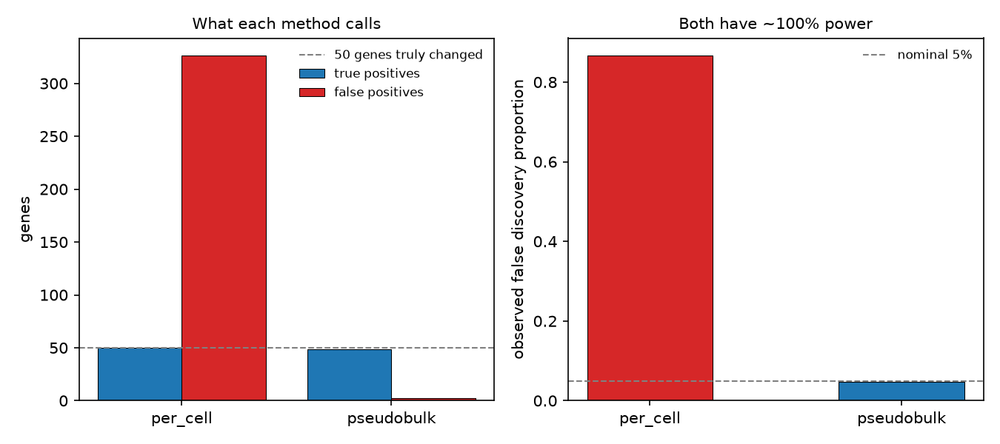

# Differential expression in single-cell data, tested at the right level

Treating every cell as a replicate is tempting, and this project measures what it costs. On simulated data where nothing changes between conditions, a per-cell Wilcoxon test called **73% of all genes significant** at a 5% false discovery rate; pseudobulk aggregation called none. The sections below repeat the test on real data, then hold two alternatives (a mixed model, a negative-binomial GLM) to the same standard.

## At a glance


*A: per-cell testing manufactures false positives on null data, simulated and real; pseudobulk does not. B: it buys no power. C: the donor-intercept mixed model is the pseudobulk test at far higher cost (§8). D: the NB GLM calls more genes but is anti-conservative on B cells and CD14+ monocytes (§9). C and D correct earlier claims of this repo.*

## The argument

Cells from one donor are not independent observations. Treating 6,400 cells from 8 donors as 6,400 samples inflates the effective sample size by three orders of magnitude, and the p-values stop meaning what they say. The replicate is the donor, because the donor is what was randomised. This is established (Squair et al. 2021, Nat Commun 12:5692) but still the default in most tutorials, so it is worth demonstrating, not citing.

## 1. False positives when nothing is happening

500 genes, 8 donors, 400 cells per donor per condition, zero genes truly changed: every call is a false positive by construction.


*Per-cell Wilcoxon calls 364.7 of 500 genes (72.9%); pseudobulk paired t calls 0.0 (BH q < 0.05, 10 replicates).*

The dashed line is the *uncorrected* p < 0.05 expectation (5% × 500 = 25). Under the Benjamini-Hochberg correction both methods use at q = 0.05, a calibrated test on all-null data calls a mean of about **0.05 of 500**, not 25: BH bounds the false-discovery *proportion* among rejections, so a correct procedure returns essentially nothing. That distinction matters for how the mixed-model null in §8 is read.

## 2. It is not buying power

The obvious defence of per-cell testing is sensitivity. With 50 of 500 genes given a real 2-fold effect, per-cell Wilcoxon calls 376.5 genes (50.0 true, 326.5 false; power 1.00, observed FDP **0.87**) and pseudobulk calls 51.3 (48.8 true, 2.5 false; power 0.98, FDP **0.05**).



*Both recover the real genes; per-cell also returns 326 that are not real, so 87% of its hit list is wrong. It is not finding more, it is calling more.*

## 3. Why — and the test that proves it

The per-cell test ignores *sample-level* variation: everything that differs between two aliquots of one donor's cells (processing day, capture efficiency, that individual's response). It sees thousands of cells agree and reads one sample's idiosyncrasy as strong evidence. If that is the cause, the test should behave when sample-level variation is zero and degrade as it grows.


*Per-cell false positives (of 500 null genes) at sample-level SD 0.00 / 0.10 / 0.20 / 0.30 / 0.50: 0.0 / 138.2 / 306.0 / 365.4 / 404.2; pseudobulk 0.0 throughout.*

It is exactly calibrated at zero and collapses at once. The per-cell test is not broken in general: it validly tests "did these cells come from the same distribution", which nobody asks. The question is whether the *condition* did something, and that has 8 replicates, not 6,400. Per-cell testing is fine for comparing cell types within one sample, where there is no sample-level confound.

## 4. Normalisation, and a bias that grows with study size

Total-count normalisation assumes every sample holds the same amount of RNA. When 50 genes go up strongly they take up more of the library, so every other gene's share falls though nothing happened to it. In the first version of the simulation this shifted every null gene by −0.07 log₂ CPM, consistently enough across donors that the paired test called 163 of them significant (a 57% false discovery rate from an otherwise correct method). Median-of-ratios size factors (as in DESeq2) fixed it, and with realistic sample-level noise the two normalisations looked identical at 8 donors.


*False discovery proportion at 8 / 20 / 40 donors: median-of-ratios 0.043 / 0.059 / 0.059, total-count CPM 0.049 / 0.098 / **0.192**.*

Composition bias is a *bias*: the same in every sample, so more donors do not average it out while sampling noise shrinks. A choice invisible at 8 donors dominates the error at 40, against the intuition that more data makes methodological choices matter less.

## 5. The same experiment on real data

Kang et al. 2018: PBMCs from 8 lupus patients, each split into a control and an interferon-β-stimulated aliquot (24,673 cells, GEO GSE96583). Taking **control cells only**, where no donor differs from any other by treatment, and randomly splitting the 8 donors into two fake "conditions" 20 times, in CD14+ monocytes:


*Per-cell Wilcoxon: median 307 false positives per split (max 988; 15.4% of the 2,000 genes tested), mean 395.9 (19.8%). Pseudobulk: median 0, max 1. The simulation was not exaggerating.*

(Share = false positives / genes tested per split, over the 20 splits in `results/false_positives.csv`. 15.4% is the *median* share, 307/2,000; 19.8% is the *mean* share. An earlier version of this row mixed the two statistics.)

## 6. The positive control, and a ranking problem

A method that calls nothing is trivially free of false positives, so check that pseudobulk still finds the real response. Interferon-β is a well-characterised programme, so the answer is known in advance. In CD14+ monocytes the effects are enormous (CXCL10 +9.8 log₂, IFIT1 +8.6, RSAD2 +8.3, ISG15 +7.7) and all are significant. But ranked by q-value, the median known interferon gene sits at **rank 441** in that type, and none is in the top 12.


*Ranking the same significant genes by effect size moves the median interferon-gene rank from 50 to 10 across the seven cell types, and the interferon genes in the top 12 from 9 of 84 to 51 of 84.*

The cause is the degrees of freedom. A paired t-test on 8 donors has 7 df, which floors the p-value (the smallest q anywhere in this analysis is 1.5 × 10⁻⁶). Hundreds of genes pile against the floor and their order is decided by noise, so a modest but very consistent change outranks a 400-fold one that wobbles between donors. Use the p-value as a filter and the effect size as the ranking.

Three "rank" definitions appear in this README and are not interchangeable; compare only inside one.

<details><summary>The three rank definitions</summary>

(a) The figure (`results/real_analysis_summary.csv`, `real_analysis.py`): rank *within the genes already significant* at BH q < 0.05, by q or by |log₂FC|, median over the 12 ISGs truncated to an integer. (b) §7 (`results/celltype_isg_recovery.csv`, `celltype_analysis.py`): the same definition from a different script; its medians differ by 1–2 for three types (CD4 73 vs 74, CD8 31 vs 32, FCGR3A+ monocytes 172 vs 170), and the cause was not isolated (re-sorting with different algorithms did not reproduce it, so it is not tie-breaking alone). (c) §9 (`results/nbglm_real_summary.csv`): rank among *all tested genes* by q, median not truncated (hence 73.5).

</details>

## 7. Cell type first, or the composition shift is the result

If the *mix* of cell types differs between conditions, a pooled comparison compares two cell mixtures, not two expression states: every marker of whichever type became more common comes out "up", with valid p-values, for a question nobody asked. On Kang the composition moves only slightly. Mean proportion ctrl → stim, with the log₂ ratio stim / ctrl: CD14+ monocytes 0.254 → 0.238 (−0.10), megakaryocytes 0.015 → 0.012 (−0.30), CD4 T 0.440 → 0.448 (+0.03), NK 0.067 → 0.068 (+0.01), B 0.098 → 0.102 (+0.07).

The largest shift is 0.30 log₂ (1.2×) and a *decrease* (megakaryocytes, 1.51% → 1.22% of cells); CD14+ monocytes also fall, in 7 of 8 donors. Every sign is the reverse of an earlier version of this table, whose `mean_ctrl` and `mean_stim` columns had been read in the wrong order. Interferon-β does not rearrange PBMC composition much, so this dataset is *not* the case where pooling fails for that reason; a disease contrast, where composition effects usually bite, would be.

<details><summary>Sign convention</summary>

The log₂ ratio above is stim / ctrl, the opposite of `results/celltype_composition_shift.csv` (`log2_ratio` = ctrl / stim; `mean_prop_a` is ctrl, `mean_prop_b` is stim; `tests/test_celltype_pseudobulk.py` pins this). Proportions come from `celltype_composition_paired.csv`, the source of record (no log₂ column).

</details>

Stratifying changes the answer anyway, because cell types respond differently (CD14+ monocytes 2,952 significant genes, CD8 T cells 88):

<details><summary>Per-type counts (table)</summary>

| cell type | donors | genes tested | significant, BH within type (global) |
|---|---|---|---|
| CD14+ Monocytes | 8 | 5,364 | 2,952 (2,578) |
| CD4 T cells | 8 | 7,048 | 986 (1,191) |
| FCGR3A+ Monocytes | 5 | 2,673 | 746 (717) |
| Dendritic cells | 5 | 2,078 | 565 (551) |
| B cells | 8 | 3,804 | 563 (661) |
| NK cells | 7 | 2,436 | 401 (459) |
| CD8 T cells | 5 | 2,081 | 88 (187) |
| Megakaryocytes | 1 | — | not testable |

</details>

**All 8 cell types are covered: 7 by an expression test, 8 by the composition test.** Megakaryocytes get a composition result (the largest shift above; paired t = −0.91, p = 0.39 on all 8 donors) and no expression result, and that exclusion is not a threshold that could be relaxed (an earlier version implied it was, by quoting only the ≥25-cell rule).


*132 cells across 8 donors, but `patient_1039` supplies 111 (84%); no cell-count threshold leaves a usable design.*

≥25 through ≥3 cells leave 1 donor, ≥2 leaves 2 (a paired t on 1 df) and ≥1 leaves 4; the loosest pairs profiles of 1 to 58 cells as equally informative replicates, with 84% of the type from one donor, and it calls 0 of 85 genes. That is a power statement, not a biological one: megakaryocytes may respond, this dataset cannot say.

<details><summary>Megakaryocyte power numbers</summary>

At the loosest threshold 85 genes survive filtering, the median paired log₂ SD is 0.80, and the minimum detectable effect at 80% power is **1.71 log₂** (exact noncentral-t, the figure to use; 1.67 log₂, 3.2×, by the central-t approximation; **7.75 log₂** with Bonferroni over 85 genes). The largest observed |log₂FC| is 3.49 (ISG15): above the per-gene minimum and well below the Bonferroni one, so one gene responding that much is not ruled out but nothing could survive correction. (An earlier sentence called 1.67 "larger than anything in the interferon programme here"; the observed ISG15 value contradicts that.) Files: `results/megakaryocyte_threshold_sweep.csv`, `megakaryocyte_summary.csv` (`expression_test_reliable = False`), `megakaryocyte_donor_counts.csv`.

</details>

Pooled over all cells, **3,211** genes are significant; stratified, **3,512** distinct genes are significant somewhere. **763** are significant pooled and in no cell type and **1,064** in at least one type and not pooled, so the pooled answer is a *different* answer, not a superset or subset. This analysis does **not** establish why. The composition shift is small (largest 0.30 log₂), so composition is unlikely to be the whole explanation; different responses being averaged, and different gene filters, are other candidates that were not separated. Only 0.52% of the 763 pooled-only genes (4 genes) are among the top-30 markers of any cell type (`pooled_sig_marker_share` in `results/celltype_analysis_summary.csv`), where a composition artefact would put marker genes.

All 12 known ISGs are significant in all 7 testable types, but the programme's *size* is cell-type specific: 2,952 genes in CD14+ monocytes against 88 in CD8 T cells. A single pooled number (3,211) describes neither.

## 8. Mixed-effects models: the middle ground, measured on all seven cell types

Pseudobulk is right about the degrees of freedom and wasteful about the
cells. The mixed model fitted here, `expression ~ condition + (1 | donor)` on
one pseudobulk profile per donor and condition, is the paired t-test's model
with a donor variance component added. Whether a *per-cell* mixed model adds
anything is a different question that this repo does not answer (see below).

**This section has been rewritten twice, and the second time the headline
reversed.** The first version ran on CD4 only and generalised from it. The
second ran all seven types and reported the mixed model as 12–272× above the
null expectation, worse the fewer the donors. That second result was an
implementation artefact, not a property of mixed models: `statsmodels` returns
Wald p-values from a *normal* reference, which is anti-conservative at 4–8
pairs, and the mixed arm was also fitted on every donor's profile rather than
the paired donors pseudobulk uses (commits `7f1e46d`, `96f8026`). With a
t(n_pairs − 1) reference on the paired donors, the numbers below are what the
code produces now (`results/mixed_vs_others_summary.csv`). Megakaryocytes stay
excluded for the reason in §7: 132 cells and no donor panel after the
min-cells filter.

Per type — cells, paired donors, and calls at BH q < 0.05:

| cell type | cells | paired donors | genes | per-cell Wilcoxon | pseudobulk paired t | mixed (1 \| donor) | mixed / pb | genes on the variance boundary | mixed wall clock |
|---|---|---|---|---|---|---|---|---|---|
| CD4 T cells | 11,238 | 8 | 7,048 | 2,112 | 986 | 1,036 | 1.05× | 34.7% | 110.2 s |
| CD14+ Monocytes | 5,697 | 8 | 5,364 | 3,836 | 2,952 | 3,068 | 1.04× | 33.2% | 83.0 s |
| B cells | 2,651 | 8 | 3,804 | 979 | 563 | 611 | 1.09× | 43.5% | 62.6 s |
| NK cells | 1,716 | 7 | 2,436 | 581 | 401 | 422 | 1.05× | 38.8% | 48.9 s |
| CD8 T cells | 1,621 | 5 | 2,081 | 366 | 90 | 92 | 1.02× | 42.2% | 36.2 s |
| FCGR3A+ Monocytes | 1,089 | 5 | 2,683 | 1,322 | 771 | 828 | 1.07× | 35.0% | 44.1 s |
| Dendritic cells | 529 | 5 | 2,084 | 901 | 562 | 609 | 1.08× | 40.4% | 24.8 s |

What the table and the files behind it support:

* **The two donor-aware methods estimate the identical effect, by
  construction.** The mixed coefficient equals the paired mean difference
  (max |difference| 7e-15 log₂FC over every gene of every type), so "Pearson
  r = 1.000" is a check that the code path is right, not evidence that two
  independent methods agree. It was below 1 in the earlier version only
  because the mixed arm had been fitted on extra unpaired profiles.
* **The test statistics agree wherever the donor variance is an estimate.**
  On genes whose fitted donor variance is above the boundary, the mixed
  Wald statistic is within 0.15% of the paired t (largest |stat/t| 1.0015 over
  all seven types). On the 33–44% of genes whose random intercept collapsed
  to zero ("converged", but a pooled fit), the mixed statistic can exceed the
  paired t by up to 1.41× (1.37 to 1.41 across types). Optimiser
  convergence is 100% on every type, and says nothing about this.
* **The mixed model calls 1.02–1.09× as many genes as pseudobulk, and 80% of
  the extra calls are boundary fits.** Mixed-only calls: 341 across the seven
  types, 273 of them on boundary genes; pseudobulk-only calls: 0. These
  are the genes where the pooled standard error is smaller than the paired
  one. This is a concrete, measured difference between the two, and it is not
  evidence that those extra genes are real.
* all 12 ISGs are significant under all three methods on all seven types.

**Timing.** The mixed fits cost 11.9–20.1 ms per gene. Against the whole
pseudobulk pipeline (cell aggregation, gene filter, paired t) that is
138× to 721× slower across the seven types; against the paired t alone on the
already-aggregated matrix (averaged over 20 repeats, 0.7–2.3 ms) it is
34,900× to 50,900×. The first range is the fair "swap one method for the
other" comparison; the second isolates the arithmetic. (An earlier
"152×–458×" used a pseudobulk time rounded to 0.1 s.)

**Per-cell mixed model: not evaluated.** The fit takes 14.6–35.1 ms per gene on
a donor-stratified subsample of at most 3,200 cells and 400 genes and
converges 99.75–100% of the time. That is all that is known. A per-cell
`(1 | donor)` model absorbs donor offsets but not the donor × condition
(aliquot) variance that §3 identifies as what breaks per-cell tests, and no
null or comparison against pseudobulk has been run for it. Nothing here
supports "cells instead of profiles buys nothing"; nothing supports the
opposite either.

### The donor-swap null, and what it can and cannot show

Permuting which of a donor's two aliquots is called "stim" makes the true
answer "nothing" for a constant effect while leaving the donor structure
intact: the permutation moves labels, never cells, `tests/test_permutation.py`
pins that, and the script re-checks it on every draw (on the frame the model
is actually fed) and raises if it fails.

**The reference.** Significance is called on Benjamini-Hochberg q < 0.05 over
the 500 genes tested. For independent exact nulls BH gives P(any rejection) =
0.05 and a mean slightly above that, not 25. `scripts/bh_null_expectation.py`
simulates it (5,000 draws, m = 500, `results/bh_null_expectation.csv`): mean
0.0552 ± 0.0035 rejections, P(any) = 0.0508. 0.05 is used as the round
reference; it holds for independent exact nulls and is not a derived bound
for a swap null on correlated genes.

**The draws.** A balanced draw flips exactly half the paired donors, so the
flipped and unflipped halves cancel for a constant effect. Draws are
*distinct* balanced plans — one per complement pair, because a plan and its
complement give the same |t| — enumerated, not resampled. With seven paired
donors one donor is held out per draw, and every draw records the donors it
used (`results/mixed_null_draws.csv`). The number of distinct draws is the
number of plans that exist, not 200: 35 for eight paired donors, 70 for seven
(six used per draw), 15 for five (four used per draw). 200 independent draws
do not exist for these panels. The null genes are the small-effect set
(|paired log₂FC| < 0.5, ISGs excluded) that §9 uses, 500 at random from
1,041–5,454 available per type; a swap of a gene whose real effect differs
between donors does not cancel in variance, so a random sample of all genes
makes any method look conservative.

| cell type | paired donors (used) | draws | pseudobulk FP/500 | mixed FP/500 | draws with ≥1 FP (Wilson 95% CI) | raw p<0.05 rate pb / mixed |
|---|---|---|---|---|---|---|
| CD4 T cells | 8 (8) | 35 | 0.029 | 0.029 | 1/35 = 0.029 (0.005–0.145) | 3.3% / 3.7% |
| CD14+ Monocytes | 8 (8) | 35 | 0.000 | 0.000 | 0/35 (0–0.099) | 3.1% / 3.5% |
| B cells | 8 (8) | 35 | 0.000 | 0.000 | 0/35 (0–0.099) | 3.4% / 3.9% |
| NK cells | 7 (6) | 70 | 0.029 | 0.029 | 2/70 = 0.029 (0.008–0.098) | 3.9% / 4.4% |
| CD8 T cells | 5 (4) | 15 | 0.067 | 0.067 | 1/15 = 0.067 (0.012–0.298) | 3.1% / 3.4% |
| FCGR3A+ Monocytes | 5 (4) | 15 | 0.000 | 0.000 | 0/15 (0–0.204) | 3.2% / 3.4% |
| Dendritic cells | 5 (4) | 15 | 0.133 | 0.133 | 1/15 = 0.067 (0.012–0.298) | 4.0% / 4.2% |

(Bootstrap CIs for the mean FP are in `results/mixed_null_donor_swap.csv`; for
example CD4 0.029, 0–0.086. The same file holds a contrast arm with an
*unbalanced* coin flip — 10 draws per type, `is_null = False`, no expected-FP
ratio — in which the unflipped donors keep their real effect, so it is not a
null.)

What this null shows, stated at the strength it has:

* Mixed and pseudobulk make **identical BH calls in 220 of 220 balanced
  draws**; no draw separates them. After the t reference, the mixed model is
  not anti-conservative on this null on any type.
* Both are consistent with the 0.05 reference (draws with at least one FP are
  0–6.7% of draws, but the CIs reach 10–30% on the 15-plan panels), and the
  data are **too few draws to tell** a calibrated test from a mildly
  anti-conservative one.
* The raw per-gene rate of p < 0.05 is 3.1–4.4%, below the 5% a calibrated
  test gives. That is what the swap null does to a gene with heterogeneous
  donor responses (the swapped contrast keeps the real between-donor
  spread, so the test sees more variance than it models). So **this null
  cannot show over-conservatism or exact calibration, only the absence of
  anti-conservatism.** "0 false positives" is the expected output of a
  conservative null for either method.
* The earlier "pseudobulk is exactly at the expectation, calibrated, not
  over-conservative" sentence was not supported and has been removed.

### The verdict, and how far it holds

On this evidence the paired t-test on pseudobulk and the (1 | donor) mixed
model on the same profiles are **the same test with different standard errors
on a third of genes**: identical effect estimates, identical statistics on
the genes where the variance component is estimated, and a pooled standard
error on the boundary genes that produces about 5% more calls, 80% of them
boundary fits. The mixed model costs more than two orders of magnitude more
computation (the Timing paragraph above) for that difference. That is a reason to prefer the
paired t-test as the default when a paired design exists; it is not a
demonstration that the mixed model is wrong, because no experiment here
distinguishes a true extra call from a false one.

What was true of the earlier version and is not true now: the null
inflation (12–272×), its dependence on the donor count (r = −0.96 across
seven types), and "the case for pseudobulk gets stronger as a study gets
smaller". That dependence was the df of the reference distribution in the
mixed arm's p-value (an implementation property, now fixed), not a property
of pseudobulk. The CD4-versus-other-types ordering ("CD4 is the most
favourable case") never held: the repo's own table had CD14 at 0.6 and CD4
at 0.8 FP/500 across 10 draws, which is noise.

## 9. The NB GLM on real data: what the simulator could not say

Everything in the "still to do" note is simulated. Power and observed FDP
both need genes whose true status is known, and the Kang data has none, so
`scripts/nbglm_real.py` asks the questions that real counts *can* answer:
do the two methods agree on the effect, do they call the same genes, are the
known ISGs found, and how does each behave under a null where the answer is
known by construction.

Same pseudobulk matrix, same gene filter, same BH correction, same paired
donors (ctrl vs 6 h IFN-β). BH q < 0.05 (`results/nbglm_real_summary.csv`):

| cell type | cells | paired donors | genes tested | pseudobulk | NB GLM | shared | Jaccard | log₂FC r |
|---|---|---|---|---|---|---|---|---|
| CD4 T cells | 11,238 | 8 | 7,048 | 986 | 1,362 | 884 | 0.604 | 1.000 |
| CD14+ Monocytes | 5,697 | 8 | 5,364 | 2,952 | 3,270 | 2,823 | 0.831 | 1.000 |
| B cells | 2,651 | 8 | 3,804 | 563 | 790 | 520 | 0.624 | 1.000 |
| NK cells | 1,673 | 7 | 2,436 | 401 | 445 | 336 | 0.659 | 1.000 |
| CD8 T cells | 1,542 | 5 | 2,081 | 88 | 168 | 75 | 0.414 | 1.000 |
| FCGR3A+ monocytes | 947 | 5 | 2,673 | 746 | 801 | 611 | 0.653 | 1.000 |
| Dendritic cells | 424 | 5 | 2,078 | 565 | 607 | 467 | 0.662 | 1.000 |

(Convention: `nbglm_real.py` first restricts each type to donors with both
conditions covered by at least the minimum cell count (`usable_subset`), and
only then aggregates, normalises and filters genes; §8's driver aggregates all
the type's cells, normalises over every donor's profile, and restricts to the
paired donors afterwards. The size factors and gene filter therefore differ,
and so do a few rows — CD8 90 vs 88, FCGR3A+ 771 vs 746, DC 562 vs 565 calls,
cells 1,621 vs 1,542 — neither is wrong; compare numbers inside one section.)

The GLM calls **more** genes in every cell type, by 7–91%, and the two
lists are far from identical: on CD4 T cells 478 genes are GLM-only against
102 pseudobulk-only. The GLM-only calls are the borderline ones — median
pseudobulk q 0.11 and median |log₂FC| 0.52, against 0.83 for the shared set —
so this is not a second biological programme, it is the GLM promoting genes
the t-test could not quite reach.

**The log₂FC column is not an independent check.** In this repo both columns
are now differences of mean log₂ of the same size-factor-normalised counts
(median-of-ratios), so r = 1.000 and max |difference| of 5e-15 is identity,
not agreement. (An earlier version reported "r 0.969–0.999, agree to three
decimals because both estimate the same group means": the GLM column then used
total-count CPM and the pseudobulk column size factors, which differ by a
per-sample composition offset — a mean |difference| of 0.447 log₂ on CD14+
monocytes — so that sentence was false as written.) The separate quantity
that *is* a comparison is the GLM's own coefficient against the pseudobulk
log₂FC on the fits that are estimates: Pearson 0.928–0.989 across the seven
types (lowest CD8 T cells, five donors).

Runtime: 0.52 s for the t-test and 2.84 s for the GLM on the 7,048 CD4 genes
(5.5×); across types the GLM costs 5.5–23× the pseudobulk pipeline, the
ratio rising as the matrices get smaller.

**Separated genes, and one ISG the GLM "misses".** Seventeen genes across four
types have a GLM coefficient beyond ±20 log₂ (a million-fold): counts in one
condition and none in the other, where the likelihood has no finite maximum
and the Wald test is not valid. They are reported as their own category
(`fit_status = "separated"`; CD14+ monocytes 7, B cells 3, NK cells 2,
dendritic cells 5), they keep p = 1, none is called, and no fit failed
outright (0). The earlier text called these "17 failed fits". The ISG
consequence is real: **CXCL10 on NK cells is one of the separated genes**
(pseudobulk q 3e-5, rank 1; GLM q = 1), so the 11-of-12 ISG recovery for
the GLM on NK cells is a separation artefact of the Wald test, not a
biological disagreement. CXCL10 is the only one of the 12 panel ISGs among the
17; the other separated genes are EDN1, PDGFRL, CH25H, ELOVL3, HRASLS2, LAG3
and BCL2L14 (CD14+ monocytes), IL1RN, LAMP3 and CXCL11 (B cells), ETV7 (NK) and
HES4, CXCL13, ANKRD22, IL27 and CCL8 (dendritic cells). Whether they are
interferon-response genes was not checked here.

**The ISGs.** All 12 are called by both methods in 6 of 7 cell types; NK is
the exception (above). Under the rank-among-all-tested-genes-by-q definition
(see §6), the median ISG rank on CD4 T cells is 73.5 under pseudobulk versus
16 under the GLM, and the same pattern holds everywhere (FCGR3A+ monocytes:
172 vs 11). The GLM orders the real signal more cleanly even where the call
counts are similar.

**The real null.** Labels swapped within donors by `permutation.swap_cells`
(no cell changes donor), BH q < 0.05, two families of draws because they
answer different questions. First the contrast on CD4 T cells across the
whole gene set, 7,048 genes (`results/nbglm_real_null.csv`):

| family | donors flipped | draws | pseudobulk FP | NB GLM FP |
|---|---|---|---|---|
| fair coin (k = 4) | 4 of 8 | 5 | 0.0 | 0.0 |
| fair coin (k = 5) | 5 of 8 | 3 | 0.0 | 41.7 |
| fair coin (k = 6) | 6 of 8 | 2 | 0.0 | 247.5 |
| balanced, k = n/2 | 4 of 8 | 35 (all distinct plans) | 0.0 | 3.69 (max 89) |

A swap of k of n donors is only null at k = n/2: at k = 6 of 8 the two
unflipped donors still carry the real interferon response and the GLM picks
it up, so the coin-flip rows read as signal, not false positives. The
strictly-null family is the balanced one. Over *all 7,048 genes* the GLM's
balanced mean is 3.69 per draw, against 0.0 for pseudobulk — but that mean is
dominated by a single plan: of the 35 distinct plans, one gives 89 false
positives and the other 34 give 0–4 (mean 1.2, median 0 over all 35). The
previous version of this section reported 0.3 (maximum 3) over ten draws
chosen by seed; this table enumerates all 35 distinct plans, and I did not
trace which plans the earlier ten were or why one plan is so heavy.
Restricting to the small-effect genes (|log₂FC| < 0.5, ISGs removed) the GLM averages 0.057
per draw on CD4, but the picture across types is not uniform:

| cell type | donors used | distinct draws | GLM FP/draw, small-effect genes (95% CI over draws) | draws with ≥1 GLM FP (Wilson CI) | pseudobulk FP/draw |
|---|---|---|---|---|---|
| CD4 T cells | 8 | 35 | 0.057 (0–0.17) | 1/35 (0.005–0.145) | 0.000 |
| CD14+ Monocytes | 8 | 35 | **1.14 (0.69–1.63)** | **14/35 (0.26–0.56)** | 0.000 |
| B cells | 8 | 35 | **2.11 (1.80–2.43)** | **35/35 (0.90–1.00)** | 0.000 |
| NK cells | 6 | 70 | 0.014 (0–0.04) | 1/70 (0.003–0.077) | 0.000 |
| CD8 T cells | 4 | 15 | 0.000 | 0/15 (0–0.204) | 0.067 |
| FCGR3A+ monocytes | 4 | 15 | 0.000 | 0/15 (0–0.204) | 0.000 |
| Dendritic cells | 4 | 15 | 0.000 | 0/15 (0–0.204) | 0.000 |

(`results/nbglm_real_null_balanced.csv`. Seven paired donors → one held out
per draw, so NK uses six; five → four.) **On B cells every one of the 35
balanced draws gives the GLM at least one false positive and on CD14+
monocytes 14 of 35 do, while pseudobulk gives none on either.** So the
GLM is anti-conservative on at least two of seven types under this null, and
the earlier sentence that it is "calibrated to the same order under a true
null" was supported by one type and ten draws and has been removed. On the
four types with five–seven donors the draws are too few (15–70) to say
anything beyond "not obviously anti-conservative". For the same swap-null
reason as §8 the null cannot show calibration; it can show
anti-conservatism, and it does so here for the GLM on B cells and CD14+
monocytes.

**The verdict on the headline.** On real data the GLM calls 7–91% more genes
than the paired t-test, ranks the ISGs higher, costs 5.5–23× the runtime,
and — unlike pseudobulk — produces false positives on a balanced
donor-swap null on B cells and CD14+ monocytes (and on CD4 when the whole
gene set is used). The simulator's *direction* on calls holds on real data;
its *magnitude* cannot be checked, which is why the 97%-vs-68% figure stays
labelled simulated (it also comes from a simulator whose negative-binomial
counts are the GLM's own model, and the dispersion-trend floor was tuned
on that simulator, so it is not out-of-sample). The extra calls are better
read as an unvalidated gain in calls than as demonstrated power: the one
real-data check that exists shows they come with a false-positive cost that
varies by cell type.

## How the simulation got fixed

The first version of this study produced the opposite of the published
result: the per-cell test looked perfectly calibrated and pseudobulk looked
broken. Both were artifacts.

The simulator applied each donor's random effect identically to that donor's
control and stimulated samples, and gave every sample the same number of
cells. Under that model a donor's two samples differ only by Poisson noise
over hundreds of cells, donor effects cancel exactly when cells are pooled,
and the per-cell test has nothing to trip over. Real experiments are not like
that. Adding an independent per-(donor, condition) effect — `sample_sd` —
reproduced the known behaviour immediately.

Worth recording because the failure mode was quiet: the code ran, produced
plausible tables, and said something false. The thing that caught it was
having a known answer to check against.

## Layout

```
src/scpipe/
    pseudobulk.py   aggregation, median-of-ratios size factors, filtering
    de.py           per-cell Wilcoxon and pseudobulk t-test, BH correction
    simulate.py     negative-binomial counts with donor and sample effects
    preprocess.py   QC thresholds and the standard scanpy pipeline
    data.py         real-dataset loading
scripts/
    simulation_study.py     the four simulation experiments
    false_positive_test.py  the null experiment on real data
    real_analysis.py        ctrl vs stim per cell type, the positive control
    nbglm_study.py          the GLM vs the t-test, simulated (power, FDP)
    nbglm_real.py           the GLM vs the t-test, real Kang counts (§9)
    mixed_vs_others.py      the mixed-model comparison of §8, all 7 cell types
    bh_null_expectation.py  simulation behind the BH all-null reference (§8)
    celltype_analysis.py    stratified analysis and composition shift (§7)
    megakaryocyte_check.py  why megakaryocytes get no expression test (§7)
    make_figures.py
tests/              121 tests, including calibration tests that assert the
                    per-cell test fails and that it stops failing when
                    sample-level variance is removed, and driver tests that
                    pin the seven-type roster and the balanced null
```

## Setup

```
pip install -e ".[dev]"
pytest
python scripts/simulation_study.py
python scripts/false_positive_test.py --cell-type "CD14+ Monocytes"
python scripts/real_analysis.py
python scripts/mixed_vs_others.py       # --types "CD4 T cells" for one
python scripts/make_figures.py
```

Note on the dataset URL: `figshare.com/ndownloader/files/34464122` looks like
a download link and is not — it is an async dispatch endpoint that answers
`202` with `Content-Length: 0`, so a naive download writes an empty file and
fails later with an unhelpful h5py error. `src/scpipe/data.py` uses the
scverse host and checks the HDF5 magic bytes and md5 before returning.

Python 3.14 has no anndata or h5py wheels yet; use 3.12 or 3.13.

## Still to do

- ~~Replace the paired t-test on log counts with a proper negative-binomial GLM
  (what DESeq2 and edgeR actually do), and check how much the normal
  approximation costs on small donor counts.~~ **Done** — `src/scpipe/nbglm.py`
  and `scripts/nbglm_study.py`; results in `results/sim_nbglm.csv`.

  The GLM is median-of-ratios size factors as an offset, per-gene method-of-
  moments dispersion shrunk toward an expression trend, and a Wald test on the
  condition coefficient referred to a t distribution with (samples − parameters)
  degrees of freedom. Measured over 10 replicates per cell of the donor grid
  (300 genes, 30 truly changed at log2 effect 1.0, BH α = 0.05): the *power* is
  the column that moved. At **6 donors** the GLM found **97%** of the changed
  genes against **68%** for the paired t-test, at the same observed false
  discovery proportion (0.028 vs 0.042). At **12 donors** both reach 100% power
  (FDP 0.057 vs 0.049) and at **24 donors** both are at 100% (FDP 0.043 vs
  0.059) — identical to two decimals. At **3 donors** neither method calls
  anything: 0% power for both, because the per-sample variance component
  swamps a 2× effect at three pairs regardless of the test. So the normal
  approximation is expensive exactly where it was suspected to be — the 3–8
  donor range where most published designs live — and free above 12. Worth
  noting that this simulator generates negative-binomial data, which is the
  GLM's own model, so this is its best case; and the dispersion-trend floor in
  `nbglm.py` was added while tuning on this same simulator, so the 97% / 68%
  figures are not out-of-sample for that choice.

  **Every number in the paragraph above is simulated, not real.** The two
  quantities it reports — power and observed FDP — need genes whose true
  status is known, and the real dataset does not have any, so they can only
  come from a simulator. Which is exactly why the hedge that used to sit here
  ("on real data the gap is unlikely to be larger than this and could be
  smaller") has been replaced by a measurement: `scripts/nbglm_real.py` runs
  both methods on the same real pseudobulk matrix, results in
  `results/nbglm_real_*.csv`. See **§9** below for what came back, and for
  what can and cannot be concluded from real counts.

## Note on how this was built

Written with Claude (Anthropic) as a coding assistant. I set the question,
chose the validation strategy, and interpreted the results. The three
findings I would defend in detail — that the per-cell failure is
specifically caused by unmodelled sample-level variance, that composition
bias grows in relative importance as a study gets larger, and that p-value
ranking is close to arbitrary at these replicate counts — all came from
following up results that did not match what was expected, instead of
accepting output that looked reasonable.
