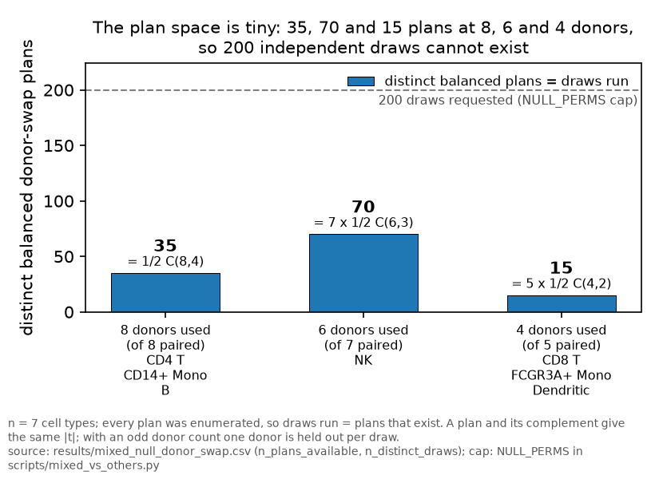
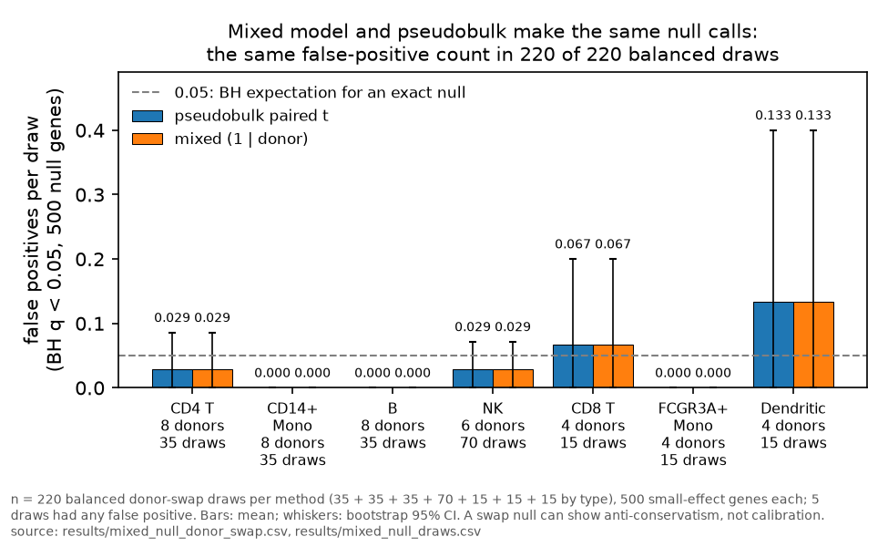

# Mixed-effects models on all seven cell types (README §8, in full)

Back to the [README](../README.md). Section numbers (§1–§9) refer to the README.

Pseudobulk is right about the degrees of freedom and wasteful about the cells. The mixed model here, `expression ~ condition + (1 | donor)` on one pseudobulk profile per donor and condition, is the paired t-test's model plus a donor variance component. A *per-cell* mixed model is not evaluated (below).

**This section was rewritten twice, and the second time the headline reversed.** The first version ran on CD4 only. The second reported the mixed model 12–272× above the null expectation, worse with fewer donors: an implementation artefact (`statsmodels` takes Wald p-values from a *normal* reference, anti-conservative at 4–8 pairs, and the mixed arm used every donor's profile, not the paired donors pseudobulk uses; commits `a1b1fc6`, `84de8aa`). The numbers below use a t(n_pairs − 1) reference on the paired donors (`results/mixed_vs_others_summary.csv`); megakaryocytes stay excluded (§7).

Calls at BH q < 0.05, per cell type (table)

| cell type | paired donors | per-cell Wilcoxon | pseudobulk paired t | mixed (1 \| donor) | mixed / pb | genes on the variance boundary |
|---|---|---|---|---|---|---|
| CD4 T cells | 8 | 2,112 | 986 | 1,036 | 1.05× | 34.7% |
| CD14+ Monocytes | 8 | 3,836 | 2,952 | 3,068 | 1.04× | 33.2% |
| B cells | 8 | 979 | 563 | 611 | 1.09× | 43.5% |
| NK cells | 7 | 581 | 401 | 422 | 1.05× | 38.8% |
| CD8 T cells | 5 | 366 | 90 | 92 | 1.02× | 42.2% |
| FCGR3A+ Monocytes | 5 | 1,322 | 771 | 828 | 1.07× | 35.0% |
| Dendritic cells | 5 | 901 | 562 | 609 | 1.08× | 40.4% |

*(Figure: `figures/mixed_boundary_genes.png`, shown in the README §8.)*

* **Same effect by construction:** the mixed coefficient equals the paired mean difference (max |difference| 7e-15 log₂FC, every gene and type), so r = 1.000 checks the code path, not agreement of independent methods (it was below 1 earlier because the mixed arm used extra unpaired profiles).
* **Same statistic where the donor variance is estimated** (within 0.15% of the paired t; largest |stat/t| 1.0015). On the 33–44% of genes whose random intercept collapsed to zero ("converged", but a pooled fit) it reaches 1.41× the paired t (1.37–1.41 across types); optimiser convergence is 100% and says nothing about this.
* **1.02–1.09× the calls, 80% of the extras on boundary fits:** 341 mixed-only calls, 273 on boundary genes; pseudobulk-only: 0. These are genes where the pooled standard error is smaller than the paired one: a measured difference, not evidence the extras are real. All 12 ISGs are significant under all three methods in all seven types.

The mixed fit costs 138× to 721× the whole pseudobulk pipeline (11.9–20.1 ms per gene). A *per-cell* mixed model is **not evaluated**: nothing here supports "cells instead of profiles buys nothing", and nothing supports the opposite.

Cells, genes and wall clock per type; timing; the per-cell mixed model

| cell type | cells | genes tested | mixed wall clock |
|---|---|---|---|
| CD4 T cells | 11,238 | 7,048 | 110.2 s |
| CD14+ Monocytes | 5,697 | 5,364 | 83.0 s |
| B cells | 2,651 | 3,804 | 62.6 s |
| NK cells | 1,716 | 2,436 | 48.9 s |
| CD8 T cells | 1,621 | 2,081 | 36.2 s |
| FCGR3A+ Monocytes | 1,089 | 2,683 | 44.1 s |
| Dendritic cells | 529 | 2,084 | 24.8 s |

**Timing.** 11.9–20.1 ms per gene for the mixed fit: 138× to 721× the whole pseudobulk pipeline (aggregation, gene filter, paired t; the fair "swap one method for the other" comparison) and 34,900× to 50,900× the paired t alone (mean of 20 repeats, 0.7–2.3 ms). An earlier "152×–458×" used a pseudobulk time rounded to 0.1 s.

**Per-cell mixed model.** 14.6–35.1 ms per gene on a donor-stratified subsample of at most 3,200 cells and 400 genes, converging 99.75–100% of the time; that is all that is known. It absorbs donor offsets but not the donor × condition (aliquot) variance that §3 blames for per-cell failure, and no null or pseudobulk comparison was run.

## The donor-swap null, and what it can and cannot show

Permuting which of a donor's two aliquots is called "stim" makes the truth "nothing" for a constant effect while keeping the donor structure; labels move, never cells (`tests/test_permutation.py` pins that; the script re-checks every draw on the frame the model is fed). Null genes are the small-effect set (|paired log₂FC| < 0.5, ISGs excluded) used in §9, 500 at random from 1,041–5,454 per type: random genes would make any method look conservative, since a swapped gene whose real effect varies between donors does not cancel in variance.

Reference and draws

The reference is BH q < 0.05 over the 500 genes: P(any rejection) = 0.05 for independent exact nulls (§1), simulated at 0.0508 with a mean of 0.0552 ± 0.0035 rejections (`scripts/bh_null_expectation.py`, 5,000 draws, m = 500; `results/bh_null_expectation.csv`). It is a round reference, not a derived bound for a swap null on correlated genes. Draws are *distinct* balanced plans, enumerated, not resampled: a balanced plan flips half the paired donors, a plan and its complement give the same |t|, and with seven paired donors one is held out per draw (`results/mixed_null_draws.csv` records the donors each draw used).

*The number of distinct draws is the number of plans that exist, not 200: 35 for eight paired donors, 70 for seven (six used), 15 for five (four used).*

*Mixed and pseudobulk make the same false-positive count in 220 of 220 balanced draws (215 with none for either); the artefact records counts, not which genes.*

Per-type numbers behind the figure

| cell type | paired donors (used) | draws | FP/500, both methods | draws with ≥1 FP (Wilson 95% CI) | raw p<0.05 rate pb / mixed |
|---|---|---|---|---|---|
| CD4 T cells | 8 (8) | 35 | 0.029 | 1/35 = 0.029 (0.005–0.145) | 3.3% / 3.7% |
| CD14+ Monocytes | 8 (8) | 35 | 0.000 | 0/35 (0–0.099) | 3.1% / 3.5% |
| B cells | 8 (8) | 35 | 0.000 | 0/35 (0–0.099) | 3.4% / 3.9% |
| NK cells | 7 (6) | 70 | 0.029 | 2/70 = 0.029 (0.008–0.098) | 3.9% / 4.4% |
| CD8 T cells | 5 (4) | 15 | 0.067 | 1/15 = 0.067 (0.012–0.298) | 3.1% / 3.4% |
| FCGR3A+ Monocytes | 5 (4) | 15 | 0.000 | 0/15 (0–0.204) | 3.2% / 3.4% |
| Dendritic cells | 5 (4) | 15 | 0.133 | 1/15 = 0.067 (0.012–0.298) | 4.0% / 4.2% |

Pseudobulk and mixed means are equal in every row; bootstrap CIs for the mean FP are in `results/mixed_null_donor_swap.csv` (CD4: 0.029, 0–0.086). That file also holds a contrast arm with an *unbalanced* coin flip (10 draws per type, `is_null = False`, no expected-FP ratio) in which the unflipped donors keep their real effect, so it is not a null.

* Mixed and pseudobulk make **the same number of false positives in 220 of 220 balanced draws**: after the t reference the mixed model is not anti-conservative on this null in any type.
* Both fit the 0.05 reference (0–6.7% of draws have ≥1 FP; CIs reach 10–30% on the 15-plan panels), but there are **too few draws to tell** calibrated from mildly anti-conservative.
* The raw per-gene rate of p < 0.05 is 3.1–4.4%, below the 5% a calibrated test gives, because the swapped contrast keeps the real between-donor spread. **The null can show anti-conservatism, not over-conservatism or exact calibration**; "0 false positives" is what a conservative null gives either method. (The earlier "pseudobulk is exactly at the expectation, calibrated" was unsupported and is removed.)

## The verdict, and how far it holds

The paired t on pseudobulk and the (1 | donor) mixed model on the same profiles are **the same test with different standard errors on a third of genes**: identical effects and statistics where the variance component is estimated, about 5% more calls on boundary genes (80% of the extras), for over two orders of magnitude more computation. That favours the paired t as the default when a paired design exists; it does not show the mixed model is wrong, because nothing here separates a true extra call from a false one.

No longer true, though true of the earlier version: the null inflation (12–272×), its dependence on donor count (r = −0.96 across seven types), "the case for pseudobulk gets stronger as a study gets smaller" (that was the degrees of freedom of the mixed arm's reference distribution, now fixed) and "CD4 is the most favourable case" (the repo's own table had CD14 at 0.6 and CD4 at 0.8 FP/500 over 10 draws: noise).
