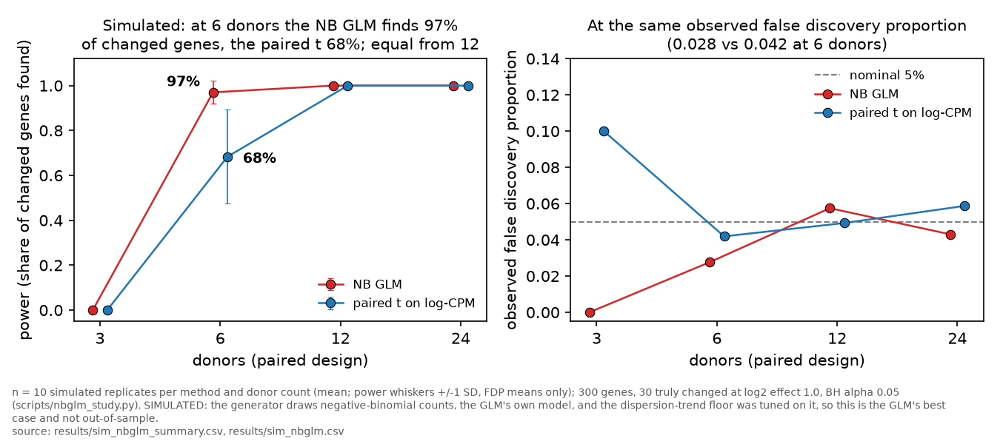
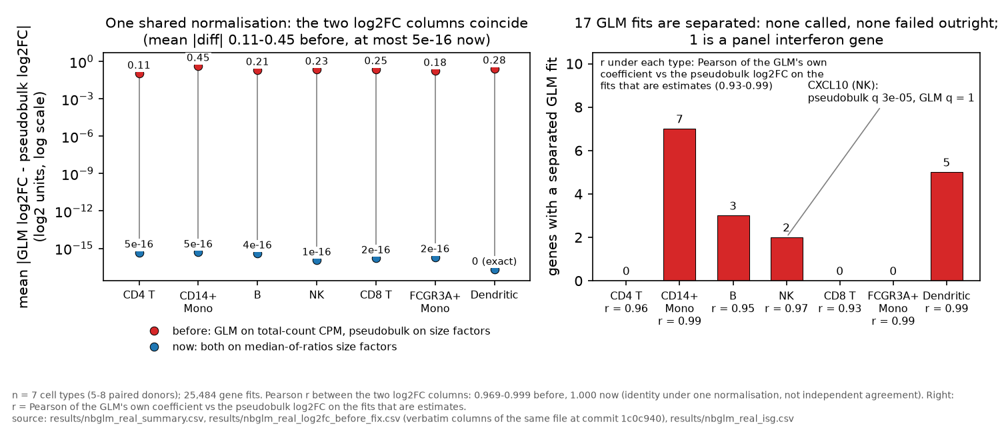

# The negative-binomial GLM (README §9, in full)

Back to the [README](../README.md). Section numbers (§1–§9) refer to the README.

## Simulated: NB GLM vs paired t-test across donor counts

(This was the README's "Still to do" item; it is done, and is kept here with its history.)

- ~~Replace the paired t-test on log counts with a negative-binomial GLM (what DESeq2 and edgeR do), and check what the normal approximation costs on small donor counts.~~ **Done**: `src/scpipe/nbglm.py`, `scripts/nbglm_study.py`, `results/sim_nbglm.csv`.

  The GLM is median-of-ratios size factors as an offset, per-gene method-of-moments dispersion shrunk toward an expression trend, and a Wald test on the condition coefficient against a t distribution with (samples − parameters) df. Over 10 replicates per cell of the donor grid (300 genes, 30 truly changed at natural-log effect 1.0, i.e. 2.72-fold or 1.44 log₂ (earlier labelled "log2 effect 1.0", which was wrong: `simulate.py` applies it inside `exp`), BH α = 0.05), power is what moved:

  

  *Simulated: at 6 donors the NB GLM finds 97% of the changed genes against 68% for the paired t-test, at the same observed false discovery proportion (0.028 vs 0.042); both reach 100% from 12 donors.*

  FDP is 0.057 vs 0.049 at 12 donors and 0.043 vs 0.059 at 24. At 3 donors neither finds a changed gene (the t-test made one false call across the 10 replicates, the GLM none), because the per-sample variance swamps a 2.7× effect at three pairs whatever the test. So the normal approximation is expensive in the 3–8 donor range where most published designs live, and free above 12. **Every number here is simulated, not real**: the generator draws negative-binomial counts (the GLM's own model) and the dispersion-trend floor in `nbglm.py` was tuned on it, so this is the GLM's best case and not out-of-sample. Real counts are in §9 (`scripts/nbglm_real.py`, `results/nbglm_real_*.csv`); that measurement replaced the hedge that used to sit here ("on real data the gap is unlikely to be larger than this and could be smaller").

## On real data: what the simulator could not say

Everything in the simulated section above is simulated, because power and observed FDP need genes of known status and the Kang data has none. `scripts/nbglm_real.py` asks what real counts *can* answer: do the methods agree on the effect, do they call the same genes, are the known ISGs found, and how does each behave under a null known by construction. Same pseudobulk matrix, gene filter, BH correction and paired donors (ctrl vs 6 h IFN-β); BH q < 0.05 (`results/nbglm_real_summary.csv`):

Calls per cell type (table), cells per type, and why a few rows differ from §8

| cell type | paired donors | genes tested | pseudobulk | NB GLM | shared | Jaccard |
|---|---|---|---|---|---|---|
| CD4 T cells | 8 | 7,048 | 986 | 1,362 | 884 | 0.604 |
| CD14+ Monocytes | 8 | 5,364 | 2,952 | 3,270 | 2,823 | 0.831 |
| B cells | 8 | 3,804 | 563 | 790 | 520 | 0.624 |
| NK cells | 7 | 2,436 | 401 | 445 | 336 | 0.659 |
| CD8 T cells | 5 | 2,081 | 88 | 168 | 75 | 0.414 |
| FCGR3A+ monocytes | 5 | 2,673 | 746 | 801 | 611 | 0.653 |
| Dendritic cells | 5 | 2,078 | 565 | 607 | 467 | 0.662 |

Cells in the usable subset: CD4 T 11,238, CD14+ monocytes 5,697, B 2,651, NK 1,673, CD8 T 1,542, FCGR3A+ monocytes 947, dendritic 424. The log₂FC Pearson r is 1.000 in every type (identity, see below).

`nbglm_real.py` first restricts each type to donors with both conditions covered by the minimum cell count (`usable_subset`), then aggregates, normalises and filters genes; §8's driver aggregates all the type's cells, normalises over every donor's profile and restricts to the paired donors afterwards. Size factors and gene filter therefore differ, and so do a few rows (calls: CD8 90 vs 88, FCGR3A+ 771 vs 746, DC 562 vs 565; cells: NK 1,716 vs 1,673, CD8 1,621 vs 1,542, FCGR3A+ 1,089 vs 947, DC 529 vs 424). Neither is wrong; compare numbers inside one section.

The GLM calls **more** genes in every type, by 7–91%, and the lists differ: on CD4 T cells 478 genes are GLM-only and 102 pseudobulk-only. The GLM-only calls are borderline (median pseudobulk q 0.11, median |log₂FC| 0.52, against 0.83 for the shared set): not a second biological programme, but the GLM promoting genes the t-test could not quite reach. It costs 5.5–23× the pseudobulk pipeline (0.52 s vs 2.84 s on the 7,048 CD4 genes, 5.5×; the ratio rises as matrices shrink).

**The log₂FC column is not an independent check.** Both columns are now differences of mean log₂ of the same median-of-ratios-normalised counts, so r = 1.000 and a max |difference| of 5e-15 is identity, not agreement. The quantity that *is* a comparison is the GLM's own coefficient against the pseudobulk log₂FC on the fits that are estimates: Pearson 0.928–0.989 across the seven types (lowest CD8 T cells, five donors). An earlier version said the columns "agree to three decimals because both estimate the same group means": the GLM column then used total-count CPM and the pseudobulk column size factors, which differ by a per-sample composition offset (mean |difference| 0.447 log₂ on CD14+ monocytes), so that sentence was false as written.

*The two log₂FC columns differed by 0.11–0.45 log₂ on average before they shared a normalisation (r 0.969–0.999) and now by at most 5e-16. Seventeen GLM fits are separated, not failed; one is the interferon gene CXCL10 on NK cells.*

**Separated genes, and one ISG the GLM "misses".** Seventeen genes in four types have a GLM coefficient beyond ±20 log₂ (a million-fold): counts in one condition and none in the other, so the likelihood has no finite maximum and the Wald test is not valid. They are their own category (`fit_status = "separated"`; CD14+ monocytes 7, B cells 3, NK cells 2, dendritic cells 5), keep p = 1, none is called, and no fit failed outright (0); the earlier text called them "17 failed fits". **CXCL10 on NK cells is one of them** (pseudobulk q 3e-5, rank 1; GLM q = 1), so the GLM's 11-of-12 ISG recovery on NK cells is a separation artefact of the Wald test, not a biological disagreement. CXCL10 is the only panel ISG among the 17; whether the other 16 are interferon-response genes was not checked.

The other 16 separated genes

EDN1, PDGFRL, CH25H, ELOVL3, HRASLS2, LAG3 and BCL2L14 (CD14+ monocytes); IL1RN, LAMP3 and CXCL11 (B cells); ETV7 (NK); HES4, CXCL13, ANKRD22, IL27 and CCL8 (dendritic cells). Also in `glm_separated_genes`, `results/nbglm_real_summary.csv`.

**The ISGs.** All 12 are called by both methods in 6 of 7 types (NK is the exception). Under definition (c) of §6 the median ISG rank on CD4 T cells is 73.5 under pseudobulk versus 16 under the GLM, and the pattern holds everywhere (FCGR3A+ monocytes: 172 vs 11): the GLM orders the real signal more cleanly even where call counts are similar.

**The real null.** Labels are swapped within donors by `permutation.swap_cells` (no cell changes donor), BH q < 0.05. Only a balanced swap (k = n/2) is a true null. On CD4 T cells over the whole gene set (7,048 genes) pseudobulk makes 0.0 false positives per draw and the GLM 3.69 (max 89), a mean dominated by a single plan: of the 35 distinct plans one gives 89 and the other 34 give 0–4 (mean 1.2 over those 34; the median over all 35 is 0). The previous version reported 0.3 (maximum 3) over ten draws chosen by seed; I did not trace which plans those were or why one plan is so heavy. On the small-effect genes (|log₂FC| < 0.5, ISGs removed) the GLM averages 0.057 per draw on CD4, but not uniformly across types:

Coin-flip families on CD4 (all 7,048 genes, <code>results/nbglm_real_null.csv</code>)

A swap of k of n donors is only null at k = n/2: at k = 6 of 8 the two unflipped donors still carry the real interferon response and the GLM picks it up, so the coin-flip rows read as signal, not false positives.

| family | donors flipped | draws | pseudobulk FP | NB GLM FP |
|---|---|---|---|---|
| fair coin (k = 4) | 4 of 8 | 5 | 0.0 | 0.0 |
| fair coin (k = 5) | 5 of 8 | 3 | 0.0 | 41.7 |
| fair coin (k = 6) | 6 of 8 | 2 | 0.0 | 247.5 |
| balanced, k = n/2 | 4 of 8 | 35 (all distinct plans) | 0.0 | 3.69 (max 89) |

*(Figure: `figures/nbglm_null_anticonservative.png`, shown in the README §9.)*

Per-type numbers behind the figure (<code>results/nbglm_real_null_balanced.csv</code>)

| cell type | donors used | distinct draws | GLM FP/draw, small-effect genes (95% CI over draws) | draws with ≥1 GLM FP (Wilson CI) | pseudobulk FP/draw |
|---|---|---|---|---|---|
| CD4 T cells | 8 | 35 | 0.057 (0–0.17) | 1/35 (0.005–0.145) | 0.000 |
| CD14+ Monocytes | 8 | 35 | **1.14 (0.69–1.63)** | **14/35 (0.26–0.56)** | 0.000 |
| B cells | 8 | 35 | **2.11 (1.80–2.43)** | **35/35 (0.90–1.00)** | 0.000 |
| NK cells | 6 | 70 | 0.014 (0–0.04) | 1/70 (0.003–0.077) | 0.000 |
| CD8 T cells | 4 | 15 | 0.000 | 0/15 (0–0.204) | 0.067 |
| FCGR3A+ monocytes | 4 | 15 | 0.000 | 0/15 (0–0.204) | 0.000 |
| Dendritic cells | 4 | 15 | 0.000 | 0/15 (0–0.204) | 0.000 |

Seven paired donors → one held out per draw, so NK uses six; five → four.

So the GLM is anti-conservative on at least two of seven types under this null; the earlier "calibrated to the same order under a true null" rested on one type and ten draws and is removed. On the four types with five to seven donors the draws (15–70) are too few to say more than "not obviously anti-conservative". As in §8, this null can show anti-conservatism, not calibration.

**The verdict on the headline.** On real data the GLM calls 7–91% more genes than the paired t-test, ranks the ISGs higher, costs 5.5–23× the runtime and, unlike pseudobulk, makes false positives on a balanced donor-swap null on B cells and CD14+ monocytes (and on CD4 with the whole gene set). The simulator's *direction* on calls holds on real data; its *magnitude* cannot be checked, so the 97%-vs-68% figure stays labelled simulated (the simulator draws negative-binomial counts, the GLM's own model, and the dispersion-trend floor was tuned on it: not out-of-sample). The extra calls are an unvalidated gain in calls, not demonstrated power; the one real-data check shows they come with a false-positive cost that varies by cell type.
